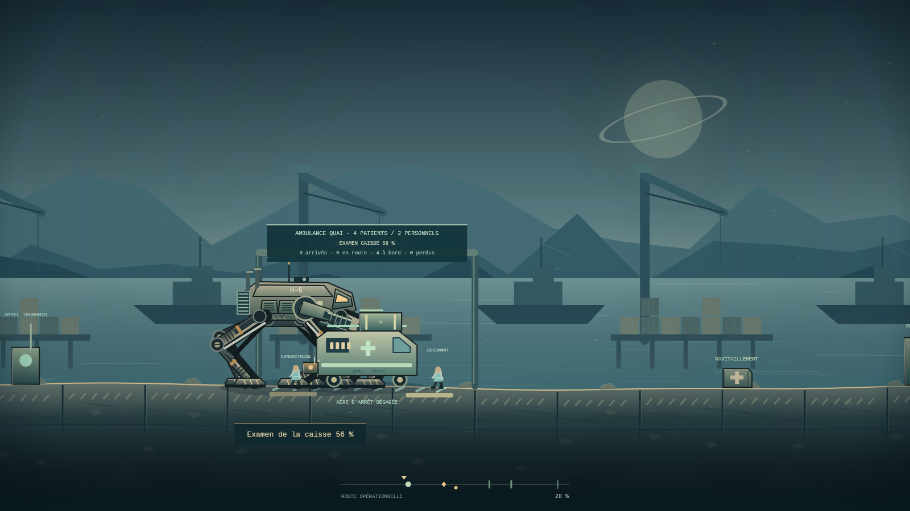

# ORDRE DE CENDRE

### Chaque pas laisse une trace.

**Nom de code : ImperiumMarch · Version 0.8.0 · Français**


Vous êtes **Sera Vey**, pilote de marcheur au service de l’Empire d’Orthe. Vous ouvrez ses routes, protégez ses convois et appliquez ses ordres. La campagne commence par une livraison utile : des filtres attendus depuis trois jours. Mais tous les quartiers ne figurent pas sur le bordereau.

**Ordre de Cendre** est un projet original de combat tactique en 2D, inspiré par le contrôle volontaire des appuis de BE-A Walker. Il développe ses propres mondes, machines, factions, personnages et récit. Sa proposition est de faire du pilotage une responsabilité matérielle : porter une machine, choisir une ligne de tir, vérifier une qualification hostile et retrouver les conséquences au retour.

Cette livraison contient un **prototype de sept missions de campagne**, six machines jouables, trois simulations indépendantes, des munitions finies, un radiateur réparable et un dossier persistant. La qualité de production visée, les huit mondes et la campagne complète restent à construire. Le [concept complet](docs/CONCEPT_COMPLET_V04.md) développe tous les domaines ; les contrats de [Vesper](docs/VESPER_CONSEQUENCES_V05.md) et de [Nacre](docs/NACRE_CONSEQUENCES_V08.md) relient leur conception à la tranche réellement jouable.

## Jouer à cette version

Ouvrir [**dist/Ordre_de_Cendre.html**](dist/Ordre_de_Cendre.html) dans un navigateur de bureau récent, après l’avoir téléchargé ou extrait du pack. Le code, les styles et les images sont intégrés. Aucun serveur ni téléchargement complémentaire n’est nécessaire pour cette édition. Le son démarre après une interaction.

1. **Campagne** : ouvrir le dossier de Sera, jouer MI01, puis MI02, MI03, MI04, MI05, MI06 et MI07, débloquées par le premier rapport de la mission précédente.
2. **Hangar** : choisir parmi six châssis. Au retour, lire les réactions de Tess et Sami et réparer avec les pièces disponibles.
3. **Reprendre la mission** : retrouver le dernier point de liaison, ses appuis, projectiles, travaux et objectifs.
4. **Simulations** : jouer les trois opérations indépendantes. Elles dévoilent des éléments ultérieurs du récit et ne modifient pas le dossier officiel.

**Exporter le dossier** crée une copie JSON transférable. Pour changer de fichier HTML, d’adresse, de navigateur ou d’appareil, exporter avant le changement puis importer dans la nouvelle version compatible. Le comportement du stockage local des fichiers ouverts directement dépend du navigateur.

La cible de publication est [darknigthmare/ImperiumMarch](https://github.com/darknigthmare/ImperiumMarch), branche `main`, liée au projet Vercel `imperium-march`. Le [dossier de déploiement](docs/DEPLOYMENT.md) distingue la construction, la liaison et la disponibilité effectivement vérifiée.

### Développement local

Depuis le dossier des sources extraites du pack, avec Node.js 22.x :

```sh
npm start
```

Ouvrir **http://localhost:4173**. Aucune dépendance à installer pour jouer, construire les sorties ou exécuter la simulation et les contrôles de DOM modélisé.

```sh
npm test
npm run build
npm run check
npm run check:ui
npm run check:ui-runtime
npm run build:web
```

`npm run test:browser` fournit un contrôle Chromium distinct, avec Playwright et un navigateur installés dans un environnement autorisé. Les outils de classeur et de rendu Canvas utilisent des dépendances de développement séparées ; elles ne sont pas requises pour jouer.

## Nouveautés de la 0.8 — Une ambulance sans escorte

**MI07 ouvre la chaussée des Salines après le bilan de MI06.** Holt désigne un transport comme dépôt mobile de munitions. Une conductrice et un soignant accompagnent quatre patients : ce groupe est distinct des passagers du chenal et des habitants de la digue.

- **Une interception à accomplir.** L'appel, le dégagement de l'aire, l'arrêt physique, l'accord à l'examen et l'inspection de la caisse sont des étapes séparées.
- **Une balise à démonter.** La pièce, ses attaches et son journal ne sont conservés qu'après le travail réel. Un boîtier détruit donne un constat de perte. L'origine de sa pose reste à recouper ; MI07 ne fabrique aucune preuve PALINODE.
- **Une route héritée du chantier.** Un panneau verrouillé sans étai et sous 65 % de fatigue autorise la rampe principale. Les autres états imposent une rampe secondaire plus longue. L'aide d'un technicien survivant exige un échange sur place.
- **Un transfert après le choix.** Le poste médical impérial et l'accueil civil sont des destinations distinctes. Choisir n'accorde aucune arrivée : le véhicule et son équipe doivent parcourir la route. Patients arrivés, pertes, personnel, véhicule saisi ou conservé et accord à témoigner gardent leurs propres faits.
- **Une sauvegarde v7.** Les vrais dossiers v1 à v6 restent importables. La nouvelle migration conserve intégralement la scène de MI06, ses rapports et son carburant. Aucun lot n'est ajouté par le passage à MI07.



*Rendu Canvas de production atteint par commandes publiques. Ce n’est pas une capture du navigateur ; les instruments HTML sont absents de cette image.*

Le [contrat MI07](docs/CAMPAIGN_MISSION_07.md), le [dossier v7](docs/CAMPAIGN_SAVE_V7.md) et les [conséquences de Nacre](docs/NACRE_CONSEQUENCES_V08.md) précisent les interactions, les variantes et leurs limites.

## Les maisons sous la ligne — conservées depuis la 0.7

**MI06 prolonge Nacre après le rapport du chenal.** Les six châssis peuvent rejoindre le chantier des Trois-Vannes. Deux maisons abritent dix habitants locaux ; ce sont d’autres personnes que les douze passagers de MI05. Leur arrivée à l’abri et l’état de leurs logements restent deux faits distincts.

- **Inspections et évacuation réelles.** E relève chaque seuil en trois secondes. Après une inspection, E peut demander l’évacuation par la radio de Mara. Les habitants marchent vers l’abri ouest, restent exposés sur le trajet et ne sont comptés sauvés qu’à l’arrivée.
- **Deux techniciens à couvrir.** Leur route dépend du passage accompli en MI05. Ils se déplacent, utilisent les couverts et peuvent subir les tirs. Une disponibilité héritée ne leur accorde pas une arrivée instantanée.
- **Soutien par les appuis.** Au repère du panneau, la coque doit être immobile et ancrée, tous les pieds posés dans la zone de soutien. Un technicien présent verrouille le panneau en six secondes. Quitter l’ancrage interrompt ce travail. Si le panneau ou les techniciens sont perdus, un étai manuel fournit une autre solution.
- **Un choix exécuté sur le terrain.** Le circuit impérial remet le quai privé en service et inonde les deux logements. La dérivation prend davantage de temps et préserve les maisons encore debout. Dans les deux cas, il faut ensuite manœuvrer la vanne à portée ; cliquer sur la décision ne termine pas le travail.
- **Carburant réellement consommé.** Les deux lots récupérés dans MI05 peuvent alimenter une auxiliaire après quatre secondes de raccordement. Une interruption avant la fin ne coûte rien. Après raccordement, les lots restent dépensés même si la pompe est détruite ou la sortie perdue. Sans carburant, la mission reste réalisable.
- **Un dossier v6 et un HUD de chantier.** Le hangar distingue réserve actuelle, dépense cumulée et coût de la dernière sortie. Le jeu affiche soutien, pression, fatigue, habitants et techniciens. Les vrais dossiers v1 à v5 restent importables.


*Rendu Canvas de production, obtenu par commandes publiques ; les instruments HTML ne sont pas inclus. Ce n’est pas une capture navigateur.*

Le [contrat MI06](docs/CAMPAIGN_MISSION_06.md), le [dossier v6](docs/CAMPAIGN_SAVE_V6.md) et les [conséquences de Nacre](docs/NACRE_CONSEQUENCES_V08.md) décrivent les règles et leurs limites. MI07 est désormais jouable ; MI08 reste conçue.

### Le chenal de MI05, conservé

La première mission de Nacre conserve la marée à quatre phases, les passerelles, les treuils, les deux barges à vérifier, le bateau de douze passagers et le dépôt facultatif de carburant. Elle distingue facture copiée, liaison avec Vann Ostre, arrivées et pertes. Aucun de ces constats locaux ne devient une preuve PALINODE. Son [contrat](docs/CAMPAIGN_MISSION_05.md) reste disponible.

## Vesper, conservé depuis la 0.5

### MI04 — Ce qui reste dans les filtres

Orison quitte une station après un rejet déclaré accidentel. Reprendre les installations demande de refroidir deux turbines, puis d’inspecter le journal du poste de maintenance. Le transport privé peut réellement se retirer : une fuite ne compte pas comme une destruction.

| Ce que Vesper a conservé | Ce qui change sur le terrain |
| --- | --- |
| Conduite intacte ou réparée | Le liquide est déjà disponible. Si elle reste rompue, brancher une pompe portative demande 5 secondes. Cela ne répare pas la conduite des maisons. |
| Au moins un ouvrier libéré du train | Son guidage ramène chaque manœuvre de refroidissement de 7 à 4 secondes. |
| Canal du dispensaire préservé | Un terminal permet un appel facultatif de 3 secondes. Seul l’appel effectué inscrit un témoignage. |
| Poste de maintenance préservé jusqu’à la lecture | Le journal copié devient PT01 : une pièce a été remplacée avant l’incident, sur ordre militaire. Le motif reste inconnu. |
| Journal détruit avant lecture | Le constat demeure possible et la mission reste terminable, sans preuve technique ; une autre source devra être recherchée plus tard. |

Une copie obtenue reste conservée si le poste est détruit ensuite. Remettre le dossier sous scellés ou joindre le constat au rapport change sa transmission, sans modifier les faits. Le bilan distingue journal, original, contact et compte rendu.


*Rendu du Canvas de production, obtenu par les commandes publiques avec le dossier historique migré. Ce n’est pas une capture navigateur et le HUD HTML n’y figure pas.*

### Une première avarie fonctionnelle

Le radiateur est localisé à l’arrière de chaque coque. Les projectiles qui l’atteignent réduisent sa santé et sa capacité de dissipation. Un tir frontal arrêté par la coque ne frappe pas le radiateur à travers elle. Le cockpit sépare température, intégrité du radiateur et refroidissement disponible, avec un minimum de dissipation de 35 %.

**T**, ou le bouton de réparation, restaure jusqu’à 60 points en quatre secondes. Le marcheur doit être immobile, tous les appuis posés. Marcher, tirer ou subir un impact interrompt le travail. Un kit n’est consommé qu’à la fin ; chaque nouvelle sortie en reçoit deux, et une reprise conserve le stock exact. Les caisses de munitions ne restaurent pas ce composant. L’atelier le remet en état contre des lots.

La coque visible suit maintenant son orientation, tandis que les contacts des pieds restent ceux de la simulation et la tourelle vise indépendamment. Une même règle de composant sur les ennemis reste à produire.

## Les acquis de la 0.4

### MI03 — Une fenêtre encore allumée

Trois émetteurs des Cales-Basses sont qualifiés de guidage hostile. Une source est bien militaire ; les deux autres desservent un dispensaire et des maisons occupées. L’ordre de Holt demeure une coupure générale.

- **Identifier sur place.** E lance le relevé à portée. Le relais militaire demande deux secondes, un bâtiment civil encore debout quatre. S’éloigner interrompt le travail. Le relevé d’un bâtiment vivant ferme la gaine de son terminal avant le passage des appuis.
- **Isoler la source militaire.** Une seconde interaction permet une coupure de deux secondes. La destruction reste possible, avec les risques ordinaires du combat.
- **Protéger des installations réelles.** Balles et explosions touchent les façades ; les appuis peuvent frapper une gaine exposée. Le passage devant le bâtiment est distinct de cette zone vulnérable. Sécuriser une gaine ne protège pas la façade contre les tirs.
- **Assumer le contrôle.** Six secondes cumulées de vérification civile déclenchent l’arrivée du drone de Holt. Il est absent du monde actif avant cet événement. Les combats aériens se déroulent dans une zone dégagée avant les maisons, permettant une approche sans dommage civil imposé.
- **Consigner ce qui reste.** Au terminal final, couper les circuits civils ou maintenir ceux qui fonctionnent. Le choix n’efface ni les dégâts ni les décès. Les ruines restent inspectables ; elles ne produisent pas des communications jamais relevées.
- **Conserver une conséquence précise.** Le dossier distingue zéro, un ou deux relais civils actifs, les habitants perdus, le dispensaire encore debout, le contrôle de Holt et la possibilité d’un contact ultérieur. MI04 permet désormais un appel facultatif par ce canal. La disponibilité du contact ne vaut pas un témoignage déjà recueilli.


*Rendu du Canvas de production depuis une partie atteinte par les commandes publiques. Les menus et le HUD HTML sont absents ; ce n’est pas une capture navigateur.*

### Six châssis, des hauteurs et des cadences différentes

| Châssis | Appuis et profil | Comportement actuel | Magasin / réserve initiale |
| --- | --- | --- | --- |
| **M-12 Vigie** | 2, haut | Longue foulée, poste de tir élevé, coque intermédiaire. | 12 / 96 |
| **C-5 Caracal** | 2, bas | Pas courts rapides, refroidissement élevé, coque légère. | 20 / 160 |
| **Q-40 Bastion** | 4, bas | Diagonales alternées, blindage, progression lente. | 10 / 80 |
| **A-17 Arpenteur** | 4, haut | Grande enjambée, cabine élevée, longue durée de pas. | 12 / 96 |
| **H-6 Pèlerin** | 6, médian | Tripodes alternés, dissipation, large emprise. | 18 / 144 |
| **CL-4 Cloporte** | 6, très bas | Coque résistante, appuis courts, tir rasant. | 14 / 112 |

Le hangar conserve une même échelle d’affichage pour comparer les silhouettes. En mission, les articulations rejoignent les contacts réels de la simulation. Les aptitudes finales de déminage, tunnel, amphibie, transport de blessés et franchissement spécial restent à produire ; un châssis jouable ne les livre pas implicitement.


*Panneau composé des rendus du hangar de production, sans interface HTML. Ce n’est pas une capture navigateur.*

### Réserves finies et ravitaillement

Chaque départ donne un magasin chargé, **huit magasins en réserve** et le stock de roquettes propre au châssis. Recharger déplace les cartouches de la réserve vers les places libres. La dernière charge peut être partielle ; à réserve vide, R ne crée rien.

Une caisse ajoute au plus **trois magasins de réserve**, deux roquettes et une réparation, dans les plafonds prévus. Elle ne se collecte qu’une fois et garde cet état après sauvegarde. La chauffe et les pauses de rechargement conservent leur rôle : une réserve abondante n’autorise pas un tir continu sans ventilation. Le HUD distingue magasin, réserve et roquettes et signale l’épuisement.

Les réserves de munitions sont propres à chaque sortie. MI05 ajoute deux lots de carburant persistants lorsque le dépôt est réellement prélevé. MI06 peut consommer ces deux lots pour sa pompe auxiliaire ; les achats, livraisons et choix d’armement restent conçus pour la campagne complète.

## Les deux premières missions conservées

### MI01 — Le couloir quarante-deux

Escorter Sami et ses **24 caisses de filtres**. La première zone laisse découvrir les appuis. Près du treuil, déployer les dalles en 4,5 secondes protège une conduite fragile ; un contact de pied peut autrement la rompre. Le camion attend pendant l’intervention ou après l’incident.

L’embuscade oblige à protéger le convoi et à gérer tir, ancrage, chaleur et rechargement. Le manifeste n’est accessible qu’après livraison. Le rapport peut rester limité au bordereau officiel ou joindre le signalement des Cales-Basses. Le quartier ne reçoit pas automatiquement des filtres supplémentaires. La conduite et le signalement reviennent dans le dossier et les répliques de l’équipage.

### MI02 — La dette sous la poussière

Deux harpons retiennent un train de minerai sur un viaduc. Chaque treuil demande 2,5 secondes à portée. Libérer le second câble met le train en mouvement vers une voie rompue. Il faut rattraper la locomotive puis tenir la liaison de freinage quatre secondes.

Huit ouvriers sont enfermés dans un wagon. Les dégâts peuvent les tuer et détruire le registre de leur vente. L’ouverture et le relevé après arrêt conservent ce qui a effectivement survécu. Une copie déjà obtenue reste copiée ; des noms perdus ne sont pas inventés au rapport. Le dossier peut être remis scellé ou accompagné du constat signé.

Les trois premières missions de Vesper établissent des faits locaux. MI04 ajoute une première pièce technique, sans révéler prématurément la chaîne de preuves PALINODE.

## Dossier, atelier et migrations

Le dossier de campagne s’enregistre toutes les **huit secondes de simulation**, à la pause, au retour, avant et après la décision et lors des événements de fermeture disponibles. Le raccordement de l’auxiliaire et une défaite de MI06 ou MI07 déclenchent aussi une sauvegarde immédiate. Une fermeture brutale peut revenir au dernier point effectivement écrit. Les opérations indépendantes gardent leurs rapports réussis, sans sauvegarde de leur partie en cours après fermeture.

Le **format v7** accepte les vrais dossiers v1, v2, v3, v4, v5 et v6. La migration conserve rapports, décisions, pièces, dégâts, phase et temps de rechargement. Les anciennes versions reçoivent les champs manquants : trois châssis neufs et une réserve documentée de huit magasins pour v1/v2, puis un radiateur neuf et deux kits pour chaque ancien checkpoint. Le dossier industriel commence sans preuve ni contact inventés. Un dossier v4 gagne uniquement Nacre non visité et zéro carburant ; tous ses checkpoints et ses quatre rapports sont conservés tels quels. Un dossier v5 gagne seulement la digue non visitée et un compteur de dépense nul ; même un transfert de carburant effectué dans une MI05 encore en cours ne crédite pas prématurément la réserve. Un dossier v6 gagne seulement l’ambulance non visitée, sans réécriture des six rapports ni du registre de carburant. La lecture ne réécrit pas l’ancien fichier ; la première sauvegarde en conserve une copie de secours.

Une version future, un format étranger ou un fichier dépassant la taille admise reste protégé contre l’écrasement automatique, même avec une copie de secours lisible. L’import explicite ou la création d’un nouveau dossier est nécessaire pour le remplacer. Si le stockage refuse une écriture, la session reste jouable et l’interface indique l’échec.

L’atelier commence avec **six lots de pièces**. Chaque première réussite de MI01 à MI07 ajoute **quatre lots**, une seule fois. Réparer coque, appuis et radiateur coûte de un à six lots ; réparer la conduite coûte deux lots. Aucune intervention d’atelier n’est possible pendant la sortie officielle.

Une relecture ne remplace pas le premier rapport, ne redonne pas de dotation et n’efface pas la sortie officielle encore en cours. Réparer un service conserve l’incident dans l’histoire. Un rapport favorable ne restaure pas un bâtiment détruit après sa signature.

## Portée réelle et cible de production

| Domaine | Livré dans la 0.8 | Cible encore à produire |
| --- | --- | --- |
| Campagne | MI01–MI07, sept rapports, conséquences de Vesper, chenal, digue et ambulance de Nacre. | 25 autres missions principales et 16 contrats. |
| Opérations indépendantes | Vesper : relais ; Nacre : escorte ; Thyr : ordre et adversaire lourd. | Campagnes des autres mondes et leurs règles propres. |
| Châssis | Six machines, deux profils par nombre d’appuis. | Six autres modèles, équipements et aptitudes spécialisées. |
| Combat | Tirs balayés, roquettes, ancrage, chauffe, appuis, radiateur localisé, deux kits finis et réserves de munitions. | Familles d’armes complètes, composants ennemis, doctrines d’escouade. |
| Monde et récit | Arc de Vesper, ouverture de Nacre, équipage et faits de sept missions. | Huit planètes complètes, neuf factions, coalition et quatre familles de fins. |
| Conception | 769 fiches, 21 onglets, concept complet, contrat causal de Vesper et suite de Nacre détaillée. | Assets, voix, animations, niveaux, réglages et tests humains de production. |

Les statuts **Conçu**, **Prototype**, **À produire** et **Vérifié** restent distincts. Les fiches ne constituent pas un pourcentage d’achèvement. Les validations portent sur des scénarios et un environnement précis.

## Commandes

| Commande | Action |
| --- | --- |
| Q ou A / D, ou flèches gauche/droite | Reculer / avancer. |
| J / L | Alterner les groupes d’appuis en marche manuelle ; maintenir une direction. |
| Souris / clic gauche | Viser / tirer. |
| Clic droit | Tirer une roquette. |
| Espace | Ancrer. |
| V | Ventiler ; le tir s’interrompt pendant la purge. |
| T | Réparer le radiateur immobile en 4 secondes avec un kit. |
| R | Recharger depuis la réserve ; automatique à vide si des cartouches restent. |
| E | Lancer un travail ou une interaction proche, puis rester à portée. |
| Échap / F | Pause / plein écran. |

Les boutons tactiles sont présents. Leur ergonomie sur matériel réel reste à valider. La hauteur de la machine change sa ligne de tir ; les bâtiments civils ne sont pas des cibles automatiques.

## Documentation

| Document | Usage |
| --- | --- |
| [Conséquences Vesper 0.5](docs/VESPER_CONSEQUENCES_V05.md) | Causalité, preuve, connaissance, composants, Nacre et critères de production. |
| [Concept complet 0.4](docs/CONCEPT_COMPLET_V04.md) | Tous les domaines : règles, contenu, récit, économie, art, accessibilité et production. |
| [Bible Excel](docs/ORDRE_DE_CENDRE_Bible.xlsx) | 21 onglets, 769 fiches, 20 tables filtrables et 126 formules. |
| [Bible générale](docs/BIBLE_FR.md) | Vision et règles communes. |
| [Campagne](docs/CAMPAIGN_FR.md) | Trente-deux missions, quatre actes et fins ; contient des révélations. |
| [MI01](docs/CAMPAIGN_MISSION_01.md), [MI02](docs/CAMPAIGN_MISSION_02.md), [MI03](docs/CAMPAIGN_MISSION_03.md), [MI04](docs/CAMPAIGN_MISSION_04.md), [MI05](docs/CAMPAIGN_MISSION_05.md), [MI06](docs/CAMPAIGN_MISSION_06.md), [MI07](docs/CAMPAIGN_MISSION_07.md) | Contrats du contenu réellement exécuté. |
| [Production 0.8](docs/PRODUCTION_V08.md) | Fiches, dépendances, prochaines étapes et critères. |
| [Validation 0.8](docs/QA_V08.md) | Preuves de tests et limites constatées. |
| [Sauvegarde v7](docs/CAMPAIGN_SAVE_V7.md), [Architecture](docs/ARCHITECTURE.md), [API simulation](docs/SIMULATION_API.md) | Contrats techniques et règles de migration. |
| [Direction artistique](docs/ART_DIRECTION.md), [provenance](docs/ASSET_PROVENANCE.md) | Art, animation, sons et origine des éléments. |
| [Déploiement](docs/DEPLOYMENT.md) | Construction web, liaison distante et état réel de publication. |
| [Données source](data/bible.json) | Les 769 fiches à identifiants stables, dont les 705 précédentes conservées. |

## Vérification et prochaine étape

La version passe **212 tests Node** et **45 parcours d’interface** dans le DOM modélisé. L’audit indépendant couvre **18 variantes**, **3 054 sauvegardes suivies de réimportation** et **1 878 restaurations exactes**. La [validation 0.8](docs/QA_V08.md) distingue les contrôles de simulation, les migrations historiques, les parcours d’interface dans un DOM modélisé, les rendus Canvas, le classeur recalculé et le navigateur réel. Les parcours MI07 couvrent les six châssis, les deux destinations, les interruptions, les pertes et les solutions de constat ou de remorquage. Une source perdue ne crée pas de preuve ; une relecture ne modifie pas le premier dossier.

Le site de jeu est [imperium-march.vercel.app](https://imperium-march.vercel.app/). Le [suivi de publication](docs/DEPLOYMENT.md) identifie le commit distant, le déploiement exact, la CI et les observations de navigateur effectivement réalisées. Les captures Canvas restent distinctes de ces observations.

La prochaine mission à produire est **MI08 — La marée compte les absents**, aux portes d’Aval. Elle doit réunir les personnes et les moyens réellement conservés à Nacre, établir les capacités des bateaux et rendre observables leurs départs. L’animation, l’audio, les essais humains, les performances mesurées et une mission de référence aboutie restent des chantiers ouverts.
