# ORDRE DE CENDRE

### Chaque pas laisse une trace.

**Nom de code : ImperiumMarch · Version 0.15.7 · Français**

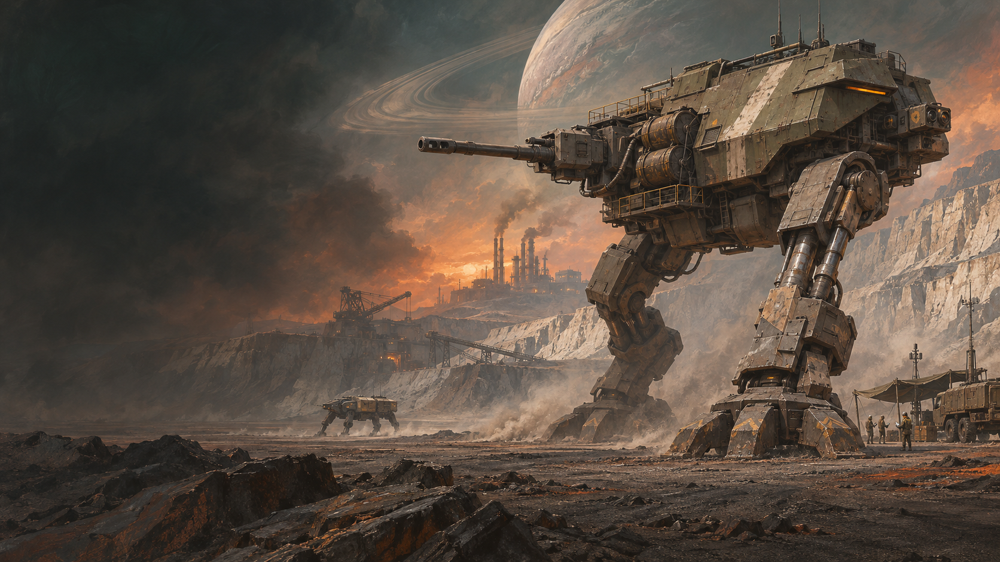

Vous êtes **Sera Vey**, pilote de marcheur au service de l’Empire d’Orthe. Vous ouvrez ses routes, protégez ses convois et appliquez ses ordres. La campagne commence par une livraison utile : des filtres attendus depuis trois jours. Mais tous les quartiers ne figurent pas sur le bordereau.

**Ordre de Cendre** est un projet original de combat tactique en 2D, inspiré par le contrôle volontaire des appuis de BE-A Walker. Il développe ses propres mondes, machines, factions, personnages et récit. Sa proposition est de faire du pilotage une responsabilité matérielle : porter une machine, choisir une ligne de tir, vérifier une qualification hostile et retrouver les conséquences au retour.

Cette livraison contient un **prototype de quatorze missions de campagne**, six machines jouables, trois simulations indépendantes, des munitions finies, un radiateur réparable et un dossier persistant **v14**. MI12 achève la tranche de Thyr ; MI13 et MI14 ouvrent Kharon par un convoi industriel puis un atelier en grève. La Bible contient **1 007 fiches sur 21 onglets**. Les dix-huit missions MI15–MI32, les seize contrats et la qualité de production visée restent à construire. Le [concept complet](docs/CONCEPT_COMPLET_V04.md) développe tous les domaines ; les contrats de [Vesper](docs/VESPER_CONSEQUENCES_V05.md) et de [Nacre](docs/NACRE_CONSEQUENCES_V09.md) relient leur conception à la tranche réellement jouable.

La **0.15.7 peint les installations de Vesper, de la route vivante et de Kharon** : treize nouveaux atlas transparents et 81 cellules pour les bâtiments, turbines, pompes, radio, treuils, harpons, barrière, camion, vannes, grues, consoles et ponts thermiques. Le total atteint **71 planches et 542 cellules**, dont 504 utilisées au rendu et 38 références. Le [bilan 0.15.7](docs/PRODUCTION_V15_7.md) détaille les trois lots et la correction du décompte historique. La campagne reste à quatorze missions ; la sauvegarde reste v14. Les bilans [installations de Nacre et Thyr](docs/PRODUCTION_V15_6.md), [transports et relais](docs/PRODUCTION_V15_5.md), [Thyr et Cerbère](docs/PRODUCTION_V15_4.md), [marcheurs](docs/PRODUCTION_V15_3.md), [combat](docs/PRODUCTION_V15_2.md), [atelier](docs/PRODUCTION_V15_1.md) et [reconstruction](docs/PRODUCTION_V14_RECONSTRUCTION.md) gardent leurs preuves historiques.

## Jouer à cette version

La **0.15.7 est publiée sur le [site du jeu](https://imperium-march.vercel.app/) et dans les sources GitHub**. La [PR #6](https://github.com/darknigthmare/ImperiumMarch/pull/6) est fusionnée sur `main` au commit [`1235102`](https://github.com/darknigthmare/ImperiumMarch/commit/1235102b25a531a90feeb0d1b38a37482a928c5d). Vercel a reçu ce même commit en production le 16 novembre 2026 à **22:09:47, heure de Paris**. Le [reçu de publication](docs/validation/v0157-publication.json) relie les sources, les deux CI réussies et le contrôle HTTP du site.

Le [rapport QA 0.15.7](docs/QA_V15_7.md) conserve **795 tests, 174 comparaisons SVG/Canvas, quatorze lots peints et 108 parcours du DOM modélisé réussis**. Une [réception navigateur limitée sur l’aperçu](docs/QA_NATIVE_V15_7.md) confirme les cinq vues, la marche et le treuil de MI01, la pause et la reprise ; ses captures n’ont pas survécu à la réinitialisation de l’environnement. Les rapports de la 0.15.6 restent dans son [reçu historique](docs/validation/v0156-publication.json) et son [rapport Chrome](docs/QA_NATIVE_V15_6.md).

**Le ZIP 0.15.7 n’est pas encore disponible dans une Release GitHub.** L’archive complète de 125 016 849 octets a été construite et vérifiée localement, puis reproduite à l’identique par les CI de la PR et de `main`. Sa publication attend l’autorisation explicite de lancer le workflow **Publish the complete offline game** ; l’examen automatique d’autorisation a refusé le clic de déclenchement. Le [suivi de publication](docs/DEPLOYMENT.md) précise l’unique action en attente, son tag `v0.15.7` et son commit exact.

Les sources permettent de construire cette édition avec `npm run build`. Extraire ensuite `Ordre_de_Cendre.html` du ZIP généré et ouvrir ce fichier dans un navigateur de bureau récent. Le code, les styles et les images originales sont intégrés ; aucun serveur ni téléchargement complémentaire n’est nécessaire pour jouer. Le son démarre après une interaction. Le [guide de distribution](docs/OFFLINE_DISTRIBUTION.md) décrit les vérifications du manifeste et de l’archive.

1. **Campagne** : ouvrir le dossier de Sera et parcourir **MI01 à MI14**, chacune débloquée par le premier rapport de la mission précédente.
2. **Hangar** : choisir parmi six châssis. Au retour, lire les réactions de Tess et Sami et réparer avec les pièces disponibles.
3. **Reprendre la mission** : retrouver le dernier point de liaison, ses appuis, projectiles, travaux et objectifs.
4. **Simulations** : jouer les trois opérations indépendantes. Elles dévoilent des éléments ultérieurs du récit et ne modifient pas le dossier officiel.

**Exporter le dossier** crée une copie JSON transférable. Pour changer de fichier HTML, d’adresse, de navigateur ou d’appareil, exporter avant le changement puis importer dans la nouvelle version compatible. Le comportement du stockage local des fichiers ouverts directement dépend du navigateur.

Les sources sont publiées sur [darknigthmare/ImperiumMarch](https://github.com/darknigthmare/ImperiumMarch), branche `main`, liée au projet Vercel `imperium-march`. Le [dossier de déploiement](docs/DEPLOYMENT.md) distingue la construction, la liaison et la disponibilité effectivement vérifiée.

### Développement local

Depuis le dossier des sources du dépôt, avec Node.js 22.x :

```sh
npm start
```

Ouvrir **http://localhost:4173**. Aucune dépendance à installer pour jouer, construire les sorties ou exécuter la simulation et les contrôles de DOM modélisé.

```sh
npm test
npm run build
npm run check
npm run check:ui
npm run check:ui-runtime
npm run check:combat
npm run check:walkers
npm run check:thyr
npm run check:cerbere
npm run check:transport
npm run check:relay
npm run check:nacre
npm run check:nacre-sites
npm run check:chemical
npm run check:voice
npm run check:vesper
npm run check:route
npm run check:foundry-sites
npm run check:offline-package
npm run build:web
```

`npm run test:browser` fournit un contrôle Chromium distinct, avec Playwright et un navigateur installés dans un environnement autorisé. Les outils de classeur et de rendu Canvas utilisent des dépendances de développement séparées ; elles ne sont pas requises pour jouer.

Les modules `relay-simulation.mjs`, `foundry-simulation.mjs` et `workshop-simulation.mjs` portent les domaines MI12–MI14 ; leurs modules `*-validation.mjs`, `*-renderer.mjs` et `*-assets.mjs` séparent faits, import, dessin et formes originales. Les commandes de production dédiées sont :

```sh
node tools/build-relay-assets.mjs
node tools/build-foundry-assets.mjs
node tools/build-workshop-assets.mjs
node tools/render-mi12-previews.mjs
node tools/render-mi13-previews.mjs
node tools/render-mi14-previews.mjs
npm run check:assets-render
```

Les outils `render-mi12/mi13/mi14-previews` produisent des scènes Canvas et des états atteints par commandes publiques. Ils ne remplacent pas un essai navigateur. Le [guide du classeur](docs/BIBLE_README.md) décrit la régénération du XLSX à partir de `data/bible.json`.

## 0.15.7 — Les sites de Vesper à Kharon

Les bâtiments MI03 possèdent leurs cinq états de fonctionnement, coupure et dommage. La protection de leur borne reste distincte de la santé des murs. MI01 reçoit son treuil, ses dalles, sa conduite et ses filtres livrés ; MI02 garde des tambours séparés et des câbles attachés au train réel. Les pompes, turbines, radio et maintenance de MI04 suivent leurs opérations existantes.

La route vivante MI09 reçoit une barrière articulée, ses postes, sa carte et le camion logistique. Les deux habitats affichés sur la carte viennent de la simulation. Dans MI13, vannes, grues, consoles, manifeste et ponts thermiques suivent l’état des sites, sans déplacer les charges ni les surfaces physiques.

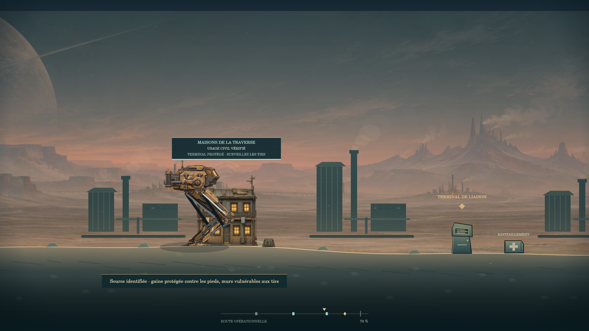

*Scène Canvas atteinte par commandes publiques du pilote MI03. Les pieds, le bâtiment et son terminal conservent leurs positions simulées. Cette image n’est pas une capture de navigateur.*

Les [originaux Vesper](assets/painted/vesper/README.md), [route MI09](assets/painted/route/README.md) et [installations MI13](assets/painted/foundry-sites/README.md) conservent prompts et métadonnées. Le [bilan de production](docs/PRODUCTION_V15_7.md) relie les trente vues Canvas, leurs états, la Bible actualisée et la nouvelle distribution hors ligne. Les autres décors, les animations finales et les missions MI15–MI32 restent à produire.

## 0.15.6 — Les installations et leurs états

Nacre reçoit ses infrastructures peintes : panneau de digue, vantaux, pompe et rotor, vannes, maisons, accueils, quais, rampes et treuils. Les ouvertures, niveaux d’eau, raccords, câbles et vraies surfaces porteuses continuent de suivre les états de mission.

Le champ chimique de MI10 reçoit ses cinq atlas : cuves, prélèvement et registre, vannes, canaux et habitats. Les nappes, volumes et travaux restent simulés. Dans MI11, les instruments d’écoute et de traduction, l’émetteur, la ponte et le repère de corniche ajoutent trois atlas. Une saisie retire réellement le haut de l’émetteur du dessin ; les copies déjà conservées ne disparaissent pas avec leurs originaux.

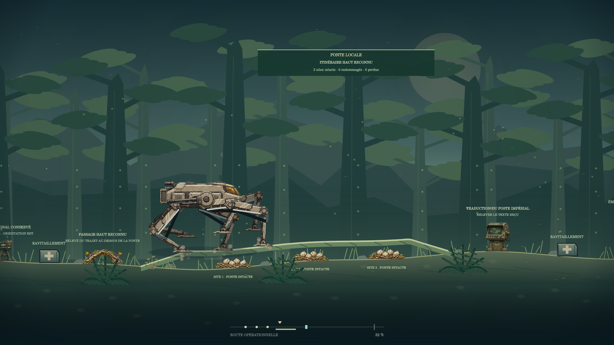

*Scène Canvas obtenue par commandes publiques du pilote MI11, sans déplacement manuel des objets. Les contacts des six pieds et la corniche restent ceux de la simulation. Cette image n’est pas une capture de navigateur.*

Les [lots Nacre](assets/painted/nacre-sites/README.md), [chimie](assets/painted/chemical/README.md) et [voix](assets/painted/voice/README.md) conservent les originaux, prompts, ancres et métadonnées. Le [rapport QA de la tranche](docs/QA_PAINTED_INSTALLATIONS.md) rassemble les réceptions et leurs limites. Le [complément Bible](docs/BIBLE_V15_6.md) actualise les fiches descriptives sans changer les statuts ni les critères historiques. Les autres décors et les animations finales restent à produire.

## 0.15.5 — Les machines des missions

Le train de MI02 reçoit une locomotive, ses wagons de minerai et de captifs, leurs avaries et leurs états ouverts. Les roues et attelages suivent le convoi ; les personnes visibles dépendent des pertes et de la libération réelles. Le porteur de MI13 conserve ses quatre roues sur le terrain et ses deux caisses indépendantes, y compris pendant le transfert vers le quai.

Sur Nacre, l’ambulance et sa caisse médicale, la balise, Rive-Courte, Veille-Aval, le bateau de réfugiés et celui de saisie possèdent leurs images. La balise disparaît du véhicule après récupération. Les coques n’ajoutent aucun passager peint aux effectifs simulés. Le Prétoire de MI12 reçoit une mécanique articulée, un canon séparé, son capteur et son verrou ; les relais et consoles reflètent leur état de copie, d’isolement ou de perte.

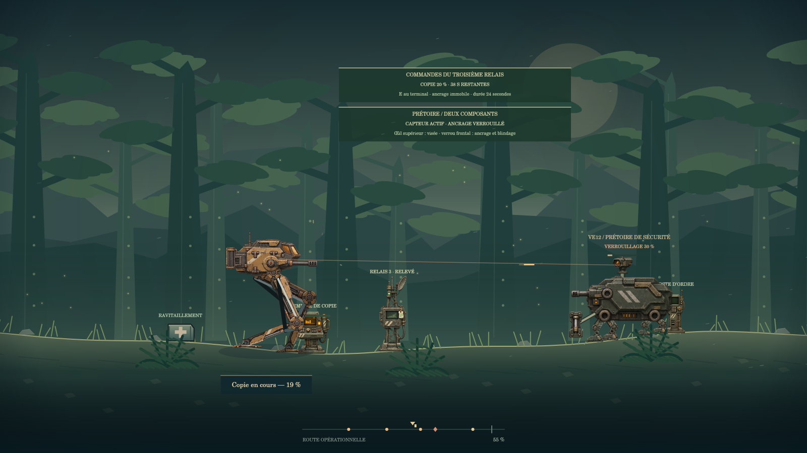

*Scène Canvas atteinte par commandes publiques : copie en cours, Prétoire arrivé et verrouillage réel. Ce n’est pas une capture de navigateur. Les [lots transport](assets/painted/transport/README.md), [Nacre](assets/painted/nacre/README.md) et [relais](assets/painted/relay/README.md) gardent les PNG sélectionnés, prompts, ancres et empreintes.*

Les 80 cellules décrivent des pièces et états des missions existantes. Le [rapport QA](docs/QA_PAINTED_MISSION_ASSETS.md) et le [complément Bible](docs/BIBLE_V15_5.md) donnent leurs contrôles et leurs limites. Les réceptions humaines, animations finales, autres factions et missions futures restent à produire.

La [PR #4](https://github.com/darknigthmare/ImperiumMarch/pull/4) est fusionnée et le [site public](https://imperium-march.vercel.app/) a reçu cette version. Les CI de la PR et de `main` passent ; les [preuves de publication](docs/validation/v0155-publication.json) et les [sept captures natives](docs/validation/native-v0155/receipt.json) rattachent les résultats au commit exact. Les trois scènes Chrome sont reprises depuis des checkpoints ; le dossier initial du navigateur est restauré à l’identique après contrôle.

## 0.15.4 — Cerbère et vie de Thyr

Cerbère dispose de sa propre coque, de ses segments, articulations, pieds, radiateur et canon peints. Son arme et son télégraphe rejoignent désormais le point de départ physique des tirs, avec les règles de combat conservées. Les chaussures gardent leurs proportions et leurs contacts au sol. Les variantes d'avarie locale restent références tant que le boss ne simule pas de santé de composants.

Thyr reçoit les Longues-dorses adultes et jeunes, les colonies d'Éventails, le Guetteur-racine de OP03, les colonnes-mères, habitats suspendus, racines, vignes et Herbes d'écho. Leth possède ses poses d'attente, d'écoute, de parole, de refus et de perte. Les cycles suivent les déplacements et états réels ; aucun personnage ou résultat de mission n'est créé par le rendu.

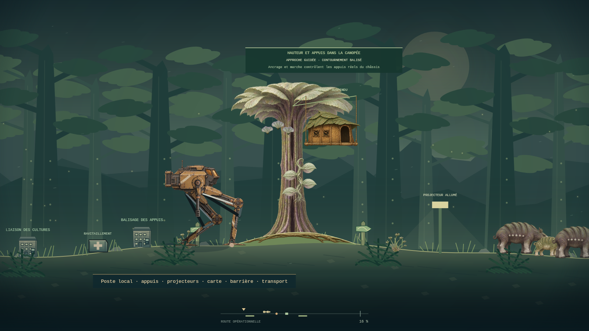

*Scène Canvas de MI09 atteinte par commandes publiques, avec les contacts réels des pieds. Ce n'est pas une capture de navigateur. Les cordes se raccordent aux points mesurés de l'habitat et les racines restent sous le contour physique du terrain.*

Les [huit atlas de Thyr](assets/painted/thyr/README.md) et [l'atlas de Cerbère](assets/painted/cerbere/README.md) conservent les PNG originaux, prompts, indexeurs, ancres et SHA-256. Les [719 tests](docs/validation/release-v0154/npm-test.txt), [réceptions Canvas](docs/QA_PAINTED_THYR_CERBERE.md) et [complément de Bible](docs/BIBLE_V15_4.md) décrivent la tranche. Chromium local a été bloqué au lancement par les permissions de l'environnement; [aucune page ni capture locale](docs/validation/browser-v0154/report.json) n'est revendiquée. Le lot reste au stade Prototype, avec réception humaine et animations finales ouvertes.

## 0.15.3 — Les six marcheurs peints

Vigie, Caracal, Bastion, Arpenteur, Pèlerin et Cloporte disposent chacun de seize cellules de pièces séparées. Les coques, segments et pieds possèdent leurs états endommagés ; la coque et le pied ont un état ancré. Les radiateurs ont trois états statiques peints, avec impact et réparation progressive conservés dans leur rendu existant.

Les pièces suivent les articulations et les contacts calculés par la simulation. Les canons restent séparés de la coque et raccordés à la bouche physique du tir, même lorsque la coque se retourne. Les membres éloignés sont assombris. Le hangar utilise les mêmes assemblages, et le repli vectoriel reste disponible après un échec de chargement.

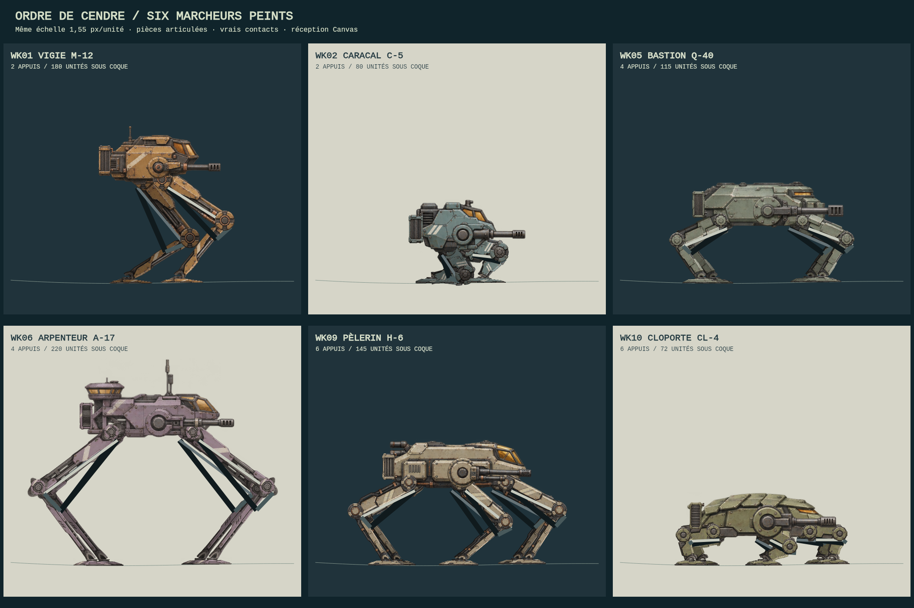

*Banc Canvas du chemin de rendu ordinaire, à 1,55 pixel par unité. Les états initiaux fournissent les vrais pieds ; leur placement dans cette planche sert la comparaison. Il ne s’agit pas d’une capture de navigateur. Les 54 poses, six scènes et six hangars sont documentés dans le [reçu graphique](docs/validation/painted-walkers-v0153/receipt.json).*

Les **96 cellules** sont des pièces et états, sans nouvelle pose complète de marche comptée. Le lot reste **Prototype** : les cycles finaux, changements de hauteur, aptitudes spécialisées et six autres châssis gardent leurs critères ouverts. Les [PNG, ancres et prompts](assets/painted/walkers/README.md), le [rapport QA](docs/QA_PAINTED_WALKERS.md) et le [complément Bible](docs/BIBLE_V15_3.md) décrivent la livraison.

## 0.15.2 — Les acteurs et véhicules peints

Le fusilier, le tireur de précision, le lance-roquettes et une silhouette civile disposent chacun d’une planche de douze cellules, dont huit poses de marche. Le buggy, le patin, le drone, la tourelle et le convoi reçoivent chacun six cellules de corps, états et pièces. **60 cellules sont employées dans le rendu ; 18 restent des références.** Les effectifs, les factions, les pertes et les arrivées restent ceux de chaque mission.

Les sept armes ennemies sont dessinées séparément. Leur pivot, leur visée et leur bouche viennent du même calcul que les projectiles ; les annonces de tir suivent cette géométrie. La marche repose sur le déplacement observé et s’arrête avec le corps. Le réglage de réduction des mouvements est conservé. Un échec de chargement laisse le rendu vectoriel disponible.

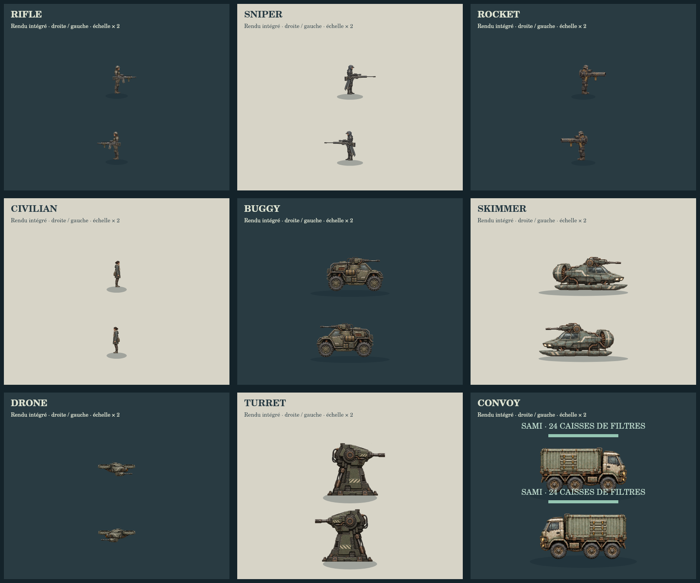

*Banc Canvas du renderer ordinaire, à l’échelle ×2. Les personnages et véhicules sont placés pour la comparaison ; cette planche n’est pas une capture de partie ni un essai navigateur. Les cinq scènes simulées et leurs empreintes figurent dans le [reçu graphique](docs/validation/painted-combat-v0152/receipt.json).*

Le lot reste **Prototype**. Les variantes de faction, la diversité des civils, les rechargements, redditions, animations finales et les autres biomes restent ouverts. Les marcheurs reçoivent leurs pièces peintes dans la tranche 0.15.3 ci-dessus. Les [PNG et leur manifeste](assets/painted/combat/README.md) conservent les prompts, les dimensions, les ancres et l’usage exact de chaque cellule. Les **697 tests de simulation et d’intégration** passent ; leur portée et les autres contrôles sont détaillés dans le [rapport QA](docs/QA_PAINTED_COMBAT.md).

## 0.15.1 — Les sprites peints de l’atelier

MI14 reçoit **huit fichiers PNG avec transparence**, rassemblant **54 cellules** de personnages, machines et accessoires. Les deux tenues d’ouvrier proposent chacune huit poses de marche, ainsi que des poses de repos, d’arrivée, de perte et une référence agenouillée. Ces images habillent les huit personnes déjà suivies individuellement par la simulation.

Le refroidisseur, la vanne, le lot, la commande, le poste du piquet et l’automate possèdent leurs états peints. Le canon de l’automate reste une pièce séparée : son pivot et sa bouche suivent la visée physique. La lecture des atlas conserve les positions, les contacts et les pertes du modèle. Le rendu vectoriel reste disponible si une image ne peut pas être décodée.

Les PNG sont conservés sans retouche après génération. Les rectangles et ancres sont définis dans `src/painted-sprite-layout.mjs`, puis utilisés par `src/painted-sprites.mjs`. Les images sont intégrées à l’édition HTML autonome. Ce lot reste au **stade prototype** : les deux poses agenouillées servent de références, et la réception humaine ainsi que les animations finales restent ouvertes. Le [bilan du lot](docs/PRODUCTION_V15_1.md) donne sa répartition exacte.

La Bible conserve ses **1 007 fiches, 21 onglets et 133 critères initiaux**. Cinq fiches existantes sont précisées ; aucun personnage, mission ou critère supplémentaire n’est déduit du nombre de cellules graphiques.

## 0.15 — Les mains noires

Holt ordonne de remettre au travail un atelier de Kharon. **Huit ouvriers refusent d’expédier un lot saboté**, tandis qu’un refroidisseur en panne et un automate de sécurité rendent le site dangereux.

- **Un piquet à traverser.** Une demande de passage sous ancrage prend trois secondes, puis les ouvriers gagnent réellement une galerie. Le joueur attend leur trajet avant de faire passer ses pieds. Les tirs, explosions et accidents conservent leurs pertes individuelles.
- **Un circuit à remettre en état.** Inspecter, isoler et réparer prennent trois, quatre et huit secondes. Un diagnostic ne ferme pas la vanne. Un organe perdu laisse un constat dégradé. Le froid réparé abaisse progressivement la température.
- **Des sources distinctes.** L’explication des ouvriers et la copie du lot exigent chacune une intervention. Le recoupement avec PT03 dépend de son acquisition dans MI13 ; une source antérieure absente reste absente.
- **Deux ordres à exécuter.** Redémarrer ou maintenir l’arrêt fixe une conduite. Il faut ensuite agir cinq secondes sur la commande de terrain. Un arrêt maintenu avec le froid réparé permet de demander une aide aux mécaniciens survivants ; ils restent sur place.
- **Une suite conservée.** Le dossier v14 ajoute l’atelier sans réécrire les treize rapports précédents. Le premier bilan donne quatre lots une fois. La relecture garde son résultat séparé. MI15 conserve ses révélations propres et la défection reste prévue à MI16.

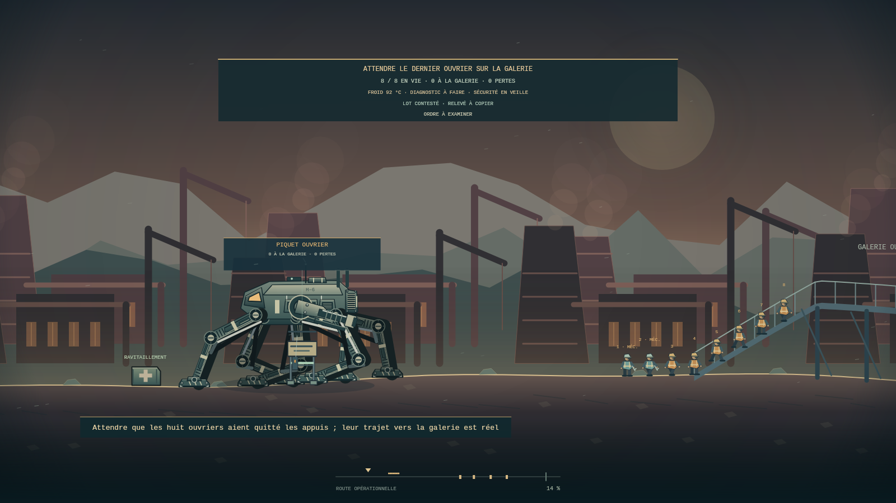

*Vue Canvas de la 0.15 : après la demande de passage, les ouvriers suivent leur trajet réel et le marcheur attend. Les [quatorze vues et sept exports](docs/validation/mi14-canvas.json) conservent les états simulés et leurs empreintes. Cette série reste distincte de la réception dans un navigateur.*

Le [contrat MI14](docs/CAMPAIGN_MISSION_14.md), le [dossier v14](docs/CAMPAIGN_SAVE_V14.md), le [registre 0.15](docs/PRODUCTION_REGISTER_V15.md) et le [rapport QA](docs/QA_V15.md) précisent la réalisation et les critères encore ouverts.

## Reconstruction 0.14.1 — Le troisième relais et les pièces de rechange

### MI12 — Le troisième relais

Après le premier rapport de MI11, Holt ordonne d’effacer trois relais de Thyr avant l’inspection d’Orison. Le troisième conserve les commandes locales du traitement chimique.

- **Une copie sous contrainte.** Relever les trois appareils ouvre une fenêtre de quarante-cinq secondes. La copie complète demande vingt-quatre secondes d’ancrage ; un départ interrompt le travail. La perte de la source avant copie ou l’expiration conserve une absence explicite. Une copie achevée reste à bord après destruction ou purge de l’original.
- **Un Prétoire matériel.** Le quadrupède de sécurité VE12 n’arrive qu’après son délai d’alerte. Son capteur supérieur commande la visée de longue portée ; son verrou hydraulique frontal maintient l’ancrage et le blindage. Leurs dégâts modifient réellement le duel.
- **Trois conduites à accomplir.** Purger trois relais, purger les deux premiers et isoler le troisième, ou refuser publiquement puis isoler les trois exige encore cinq secondes d’intervention par appareil. Le choix ne répare aucun relais et ne réalise aucun travail à distance.
- **Des conséquences limitées aux faits.** Ilan distingue les commandes vues d’une archive perdue. Holt constate les écarts ; le refus ouvert ferme le refuge impérial. La mission conserve une provenance industrielle locale, sans attribuer une nouvelle preuve politique ni anticiper la défection de MI16.

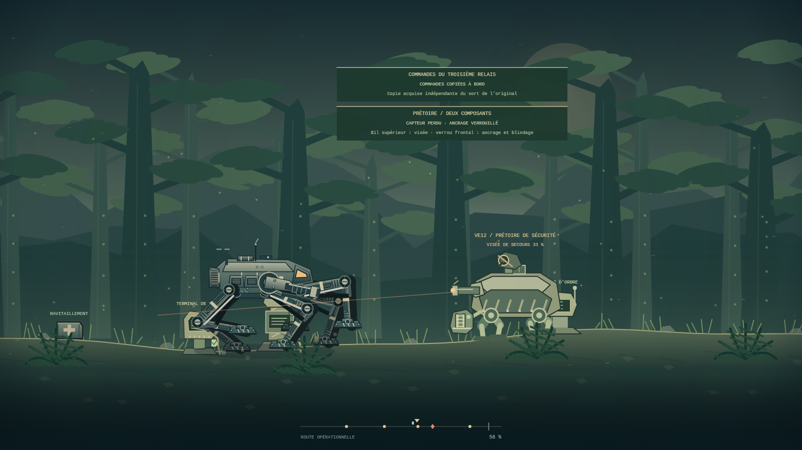

*Scène Canvas de la reconstruction, atteinte par les commandes publiques. La géométrie du Prétoire et ses quatre appuis viennent de la simulation. Ce rendu n’est pas une capture de navigateur.*

### MI13 — Pièces de rechange

La première mission de Kharon escorte un porteur industriel chargé de deux caisses vers la fonderie centrale.

- **Des ponts qui chauffent les contacts réels.** Les deux tabliers portent les vrais pieds et roues. Une vanne manœuvrée pendant quatre secondes coupe son jet et refroidit progressivement le circuit. Chaleur ambiante, conduction et vapeur restent séparées ; les jets possèdent une annonce visible.
- **Un convoi et des sources distinctes.** Le porteur, ses deux caisses et le bordereau peuvent subir des pertes. Deux drones et une tourelle apparaissent après le délai de l’embuscade. Les marquages demandent trois secondes chacun, le bordereau quatre secondes et l’analyse embarquée de Tess huit secondes.
- **PT03 avec sa provenance.** La preuve industrielle exige les deux marquages, le bordereau et l’analyse achevée. Les recoupements avec PT01 ou les commandes de MI12 n’existent que si ces sources ont été acquises. Les copies restent conservées quand les originaux sont ensuite perdus.
- **Deux quais et un transfert réel.** Livrer ou mettre en quarantaine fixe une destination. Le porteur doit la rejoindre, puis chaque caisse survivante effectue son transfert de cinq secondes. Un transfert partiel conserve sa position et sa progression ; une perte n’est pas réparée par le rapport.

Le [bilan de production reconstruit](docs/PRODUCTION_V14_RECONSTRUCTION.md), le [format de dossier v13](docs/CAMPAIGN_SAVE_V13.md) et le [rapport QA](docs/QA_RECONSTRUCTION_014.md) détaillent les comportements reçus et leurs limites. Les anciens comptes rendus ci-dessous gardent leur version et leur portée historiques.

## Livraison historique — 0.12, une voix au ras du sol

**MI11 poursuit Thyr après le premier rapport du champ chimique.** Holt ordonne de saisir un émetteur khelte. Retrouver sa source demande des écoutes dans les racines, puis un passage attentif au-dessus d’un site de ponte. La rencontre avec **Leth de la Septième Rive** permet de confronter le signal source à sa traduction impériale.

- **Trois écoutes sous ancrage.** Chacune demande quatre secondes, des pieds immobiles et aucun tir. Un relevé interrompu doit être relancé ; un poste perdu laisse un constat sans signal inventé.
- **Une corniche qui porte les vrais pieds.** Après reconnaissance, sa surface protège le passage au-dessus des trois sites de ponte. Les tirs, explosions ou appuis au sol peuvent les endommager. Les six châssis disposent d’un trajet effectivement franchissable.
- **Un interprète dont l’accord compte.** Rencontrer Leth, demander son accord privé et enregistrer vingt secondes d’échange sont trois actes distincts. Des forces privées arrivent pendant la séquence ; leur arrivée est un événement réel. Le refus, le retrait et la mort ne produisent aucun témoignage fictif.
- **Trois phrases déformées à comparer.** Le texte impérial ne figure dans les archives qu’après sa copie ; les restitutions françaises de Leth apparaissent après son échange achevé. Avertissement original, traduction et témoignage restent trois sources distinctes.
- **Deux interventions matérielles.** Saisir l’émetteur ou remettre en service son canal d’avis demande cinq secondes au dispositif. Le dialogue choisit une conduite ; il ne réalise pas le travail. Le rapport précède l’extraction.
- **TE01, avec une portée précise.** La pièce réunit trois signaux exploitables, les deux copies et le témoignage consenti achevé. Une archive acquise survit à une destruction ultérieure ; la disponibilité du témoin reste séparée. Cette découverte ne démontre pas les ordres industriels de MI12 ni toute la chaîne PALINODE.
- **Dossier v11 et production originale.** Les dix rapports précédents et leurs ressources restent exacts. Six nouveaux composants, vingt-six SVG et deux planches partagent la géométrie utilisée dans le jeu. La Bible passe à **905 fiches sur 21 onglets**.

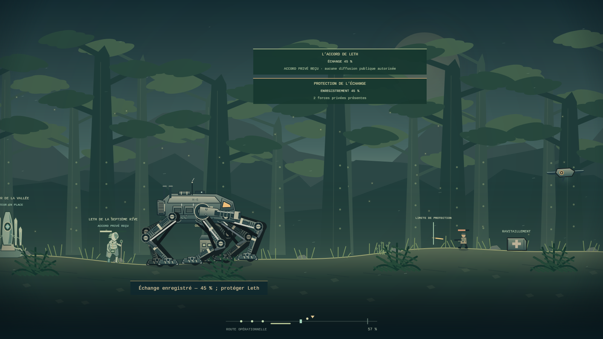

*Rendu Canvas de l’application depuis un état atteint par les commandes publiques. L’état est copié et le renderer est contrôlé sans mutation. Cette image ne constitue pas une capture de navigateur.*

Le [contrat MI11](docs/CAMPAIGN_MISSION_11.md), la [sauvegarde v11](docs/CAMPAIGN_SAVE_V11.md), le [lot graphique](assets/voice/README.md), le [registre de production 0.12](docs/PRODUCTION_REGISTER_V12.md) et la [validation 0.12](docs/QA_V12.md) précisent la réception et les limites. Leth demeure sur le site ; aucun recrutement ni accord de diffusion publique n’est accordé.

## Livraison précédente — 0.11, le champ que personne n’a semé

**MI10 prolonge Thyr après le premier rapport de « La route des vivants ».** Holt ordonne de détruire une réserve chimique attribuée aux rebelles. Trois cuves bordent les canaux d’un village ; une fuite est déjà active. Le relevé matériel doit précéder toute conclusion sur le contenu du site.

- **Trois identifications réelles.** Chaque cuve porte son propre marquage. Le registre des lots exige une copie séparée. Relever des ruines conserve un constat de perte, sans recréer les inscriptions détruites.
- **Un prélèvement à défendre.** La collecte prend vingt secondes dans la zone du préleveur. Trois forces privées entrent après leur délai d’alerte. La source et l’appareil peuvent être perdus avant la collecte ; après celle-ci, les pièces conservées à bord survivent à la destruction des originaux.
- **Deux conduites matérielles.** La démolition et la mise en sécurité demandent une opération sur chaque cuve encore debout. Une réponse au dialogue ne détruit ni n’isole les équipements.
- **Des volumes traçables.** La fuite et les ruptures libèrent des nappes qui parcourent réellement le terrain. Le collecteur peut les dévier vers un bassin distinct. Les volumes retenus, livrés et encore en transit sont réconciliés. Le bassin n’est pas destructible dans ce prototype.
- **L’eau du village.** Deux canaux peuvent être couverts avant le passage des pieds. Les tirs et les appuis peuvent dégrader les ouvrages. Le retour de l’eau ne supprime aucune contamination ; le bilan distingue circulation rétablie et village habitable.
- **La pièce technique PT02.** Elle exige la matière prélevée, les trois marquages et le registre matériel d’Orison. Elle ne reconstitue pas toute la chaîne de financement et de commandement. Dans cette tranche historique, TE01 restait prévue à MI11 ; elle est désormais jouable dans la 0.12. La défection reste à MI16.
- **Un dossier v10 et un lot graphique original.** La migration du vrai dossier v9 conserve ses neuf rapports, son inventaire et ses scènes. Six nouveaux composants, vingt-quatre SVG et deux planches partagent les formes utilisées par le jeu. La Bible contient 873 fiches sur 21 onglets.

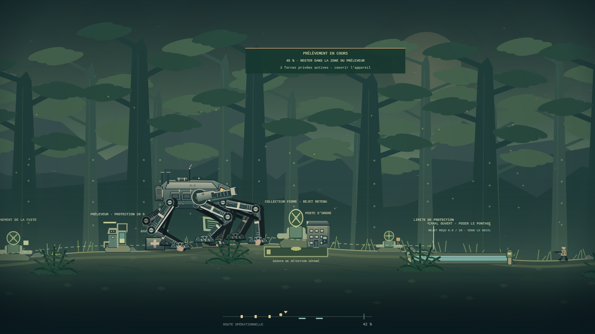

*Rendu Canvas du jeu depuis un état atteint par les commandes publiques, avec état profondément copié et empreintes des sources. Cette image ne constitue pas une capture de navigateur.*

Le [contrat MI10](docs/CAMPAIGN_MISSION_10.md), la [sauvegarde v10](docs/CAMPAIGN_SAVE_V10.md), le [lot graphique](assets/chemical/README.md), le [registre de production 0.11](docs/PRODUCTION_REGISTER_V11.md) et la [validation 0.11](docs/QA_V11.md) décrivent les opérations, les résultats et les limites de la tranche.

## Livraison précédente — 0.10, la route des vivants

**MI09 ouvre l’affectation sur Thyr après le rapport d’Aval.** La route déclarée sauvage traverse deux colonnes vivantes, leurs racines porteuses, deux habitats suspendus et la migration de quatre longues-dorses. Les cartes militaires omettent les maisons. Le poste des cultures peut expliquer le passage et guider une approche adaptée au châssis.

- **Des appuis matériels.** Les vrais pieds se posent sur les racines. Un passage trop bas arrête les coques hautes jusqu’à la reconnaissance d’un contournement. Un guidage local exige un échange puis un balisage ; la cadence manuelle reste possible.
- **Deux routes à accomplir.** L’ordre impérial détourne les animaux vers l’exclusion. Préserver la migration les conduit au verger avant le passage logistique. Le choix ne manœuvre pas la barrière et ne téléporte aucun animal.
- **Une écologie locale.** Les projecteurs et les tirs dispersent les éventails ; le calme permet leur retour. Une racine ou une colonne rompue fait perdre le support du logement. Animaux arrivés, détournés et perdus restent individualisés.
- **Un trajet logistique.** Deux tireurs arrivent après la résolution du troupeau. Le transport doit être libéré, couvert et réellement arrivé avant la transmission du rapport et l’extraction. Sa destruction est une défaite.
- **Une sauvegarde v9.** Les huit rapports précédents, leur inventaire et leurs scènes sont conservés. La migration ajoute uniquement le volet de Thyr vide et le numéro de version. Une ancienne étape finale reste intacte ; la progression propose ensuite MI09.
- **Des commandes relâchées au changement de focus.** Le clavier est lié au canvas, les boutons conservent leur activation native et une répétition ne réarme pas une touche après une pause. La capture perdue du pointeur cesse le tir. La validation DOM et l’observation native sont distinguées dans le rapport QA.
- **Un kit original de Thyr.** Onze composants, trente-cinq SVG et deux planches PNG partagent la géométrie utilisée dans le jeu. Les membranes FL08 sont décoratives dans cette tranche et FL09 réagit visuellement ; leurs systèmes complets restent conçus.

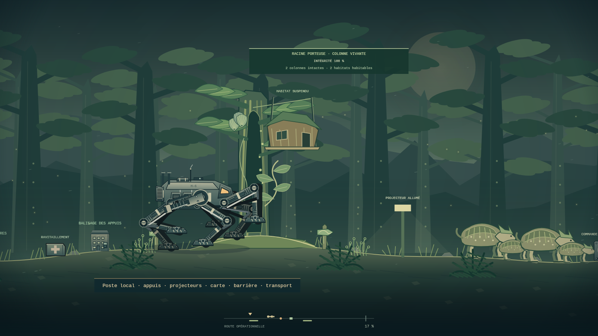

*Rendu Canvas de l’application à partir d’un état atteint par les commandes publiques. Le manifeste conserve l’état copié et les empreintes des sources. Cette image n’est pas une capture Chrome.*

Le [contrat MI09](docs/CAMPAIGN_MISSION_09.md), la [sauvegarde v9](docs/CAMPAIGN_SAVE_V9.md), le [lot de Thyr](assets/thyr/README.md), le [registre de production 0.10](docs/PRODUCTION_REGISTER_V10.md) et la [validation 0.10](docs/QA_V10.md) décrivent les actes, les résultats et les limites. MI09 n’établit ni PT02, ni TE01, ni la chaîne globale PALINODE ; la défection reste prévue à MI16.

## Livraison précédente — 0.9, les portes d’Aval

**MI08 achève l’affectation de Nacre après le bilan de MI07.** Les portes d’amenée et de passage ont des fonctions et des mécanismes distincts. Retrouvez les survivants, confirmez les places du refuge, préparez les passerelles et recueillez les accords. La fermeture immédiate, une fenêtre suivie de fermeture et le maintien du passage sont trois conduites à accomplir sur le terrain.

- **Des personnes et des trajets conservés individuellement.** Places assises, brancards, opérateurs et accompagnants ont des contraintes distinctes. Une personne embarquée n’est pas encore partie ; un bateau parti n’est pas encore arrivé. Les replis locaux sont comptés à l’accueil.
- **Un dossier v8 qui conserve les versions antérieures.** Les rapports historiques restent inchangés. Le nouveau recensement d’Aval conserve ses identités et destinations sans inventer celles que les anciens rapports ne donnaient pas.
- **Des pièces graphiques réutilisables.** Six rigs, des pièces et états SVG, douze silhouettes et des composants de Nacre partagent leur géométrie avec le Canvas. La production, les pivots et la provenance sont documentés.
- **Une bibliothèque sonore originale.** Huit ambiances planétaires, trois motifs et quarante-quatre signaux sont synthétisés sans chargement réseau, avec des exports WAV pour revue.
- **Des commandes configurables.** Onze actions clavier peuvent être réaffectées. Les manettes standard commandent la mission ; les menus et décisions restent au clavier ou à la souris. Les essais physiques et humains restent à effectuer.
- **Un registre des 133 « À produire ».** Les critères d’origine sont conservés avec les livraisons reçues, les preuves et le travail restant. Les lignes ne sont pas déclarées terminées par simple changement d’étiquette.

Le [contrat MI08](docs/CAMPAIGN_MISSION_08.md), le [format de sauvegarde v8](docs/CAMPAIGN_SAVE_V8.md), les [commandes et le son](docs/CONTROLS_AUDIO_V09.md), le [lot graphique et audio](assets/production/README.md) et le [registre de production](docs/PRODUCTION_REGISTER_V09.md) détaillent cette livraison.

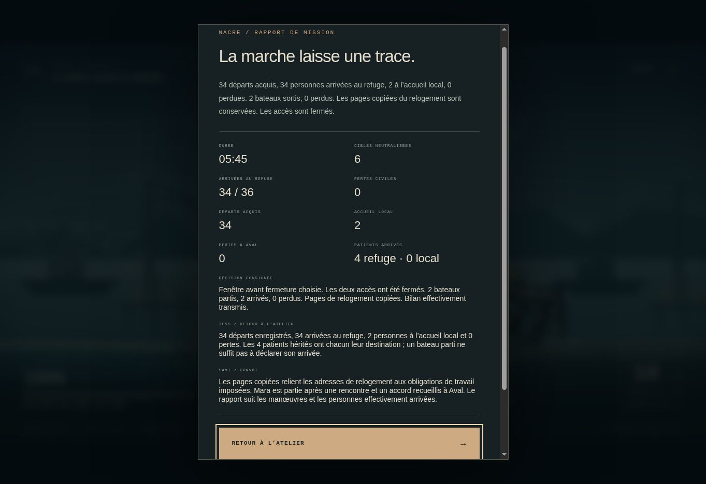

*Capture native de la publication 0.9 corrigée. Le parcours reprend un export réel de porte partiellement ouverte, issu du contrôle initial dont le départ avait été préparé par les commandes publiques. L’ouverture, les départs, la fermeture, les arrivées, la transmission et l’extraction sont ensuite accomplis dans Chrome, sans nouvel import. Les [deux corrections textuelles et ce résultat à 05:45](docs/validation/v09-browser-postfix.json) ont été observés sur la version publiée ; les exports finaux restent identiques après recharge. Ce parcours ne constitue pas une partie intégrale depuis le début de MI08. Les [observations initiales](docs/validation/v09-browser.json), dont l’anomalie de perte de focus encore ouverte, sont conservées séparément.*

## Une ambulance sans escorte — conservée depuis la 0.8

**MI07 ouvre la chaussée des Salines après le bilan de MI06.** Holt désigne un transport comme dépôt mobile de munitions. Une conductrice et un soignant accompagnent quatre patients : ce groupe est distinct des passagers du chenal et des habitants de la digue.

- **Une interception à accomplir.** L'appel, le dégagement de l'aire, l'arrêt physique, l'accord à l'examen et l'inspection de la caisse sont des étapes séparées.
- **Une balise à démonter.** La pièce, ses attaches et son journal ne sont conservés qu'après le travail réel. Un boîtier détruit donne un constat de perte. L'origine de sa pose reste à recouper ; MI07 ne fabrique aucune preuve PALINODE.
- **Une route héritée du chantier.** Un panneau verrouillé sans étai et sous 65 % de fatigue autorise la rampe principale. Les autres états imposent une rampe secondaire plus longue. L'aide d'un technicien survivant exige un contact radio au repère d’intervention.
- **Un transfert après le choix.** Le poste médical impérial et l'accueil civil sont des destinations distinctes. Choisir n'accorde aucune arrivée : le véhicule et son équipe doivent parcourir la route. Patients arrivés, pertes, personnel, véhicule saisi ou conservé et accord à témoigner gardent leurs propres faits.
- **Une sauvegarde v7.** Les vrais dossiers v1 à v6 restent importables. La nouvelle migration conserve intégralement la scène de MI06, ses rapports et son carburant. Aucun lot n'est ajouté par le passage à MI07.

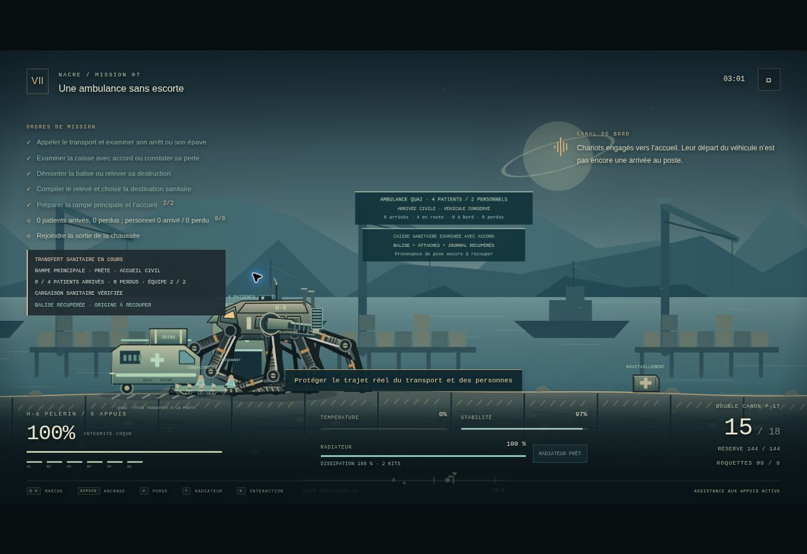

*Capture réelle du site publié dans Chrome. Le parcours reprend un point de transfert préparé par les commandes publiques de simulation ; les patients rejoignent ensuite l’accueil dans le navigateur. Le [rapport navigateur](docs/validation/v08-browser.json) distingue précisément la préparation et les actions natives.*

Le [contrat MI07](docs/CAMPAIGN_MISSION_07.md), le [dossier v7](docs/CAMPAIGN_SAVE_V7.md) et les [conséquences de Nacre](docs/NACRE_CONSEQUENCES_V08.md) précisent les interactions, les variantes et leurs limites.

## Les maisons sous la ligne — conservées depuis la 0.7

**MI06 prolonge Nacre après le rapport du chenal.** Les six châssis peuvent rejoindre le chantier des Trois-Vannes. Deux maisons abritent dix habitants locaux ; ce sont d’autres personnes que les douze passagers de MI05. Leur arrivée à l’abri et l’état de leurs logements restent deux faits distincts.

- **Inspections et évacuation réelles.** E relève chaque seuil en trois secondes. Après une inspection, E peut demander l’évacuation par la radio de Mara. Les habitants marchent vers l’abri ouest, restent exposés sur le trajet et ne sont comptés sauvés qu’à l’arrivée.
- **Deux techniciens à couvrir.** Leur route dépend du passage accompli en MI05. Ils se déplacent, utilisent les couverts et peuvent subir les tirs. Une disponibilité héritée ne leur accorde pas une arrivée instantanée.
- **Soutien par les appuis.** Au repère du panneau, la coque doit être immobile et ancrée, tous les pieds posés dans la zone de soutien. Un technicien présent verrouille le panneau en six secondes. Quitter l’ancrage interrompt ce travail. Si le panneau ou les techniciens sont perdus, un étai manuel fournit une autre solution.
- **Un choix exécuté sur le terrain.** Le circuit impérial remet le quai privé en service et inonde les deux logements. La dérivation prend davantage de temps et préserve les maisons encore debout. Dans les deux cas, il faut ensuite manœuvrer la vanne à portée ; cliquer sur la décision ne termine pas le travail.
- **Carburant réellement consommé.** Les deux lots récupérés dans MI05 peuvent alimenter une auxiliaire après quatre secondes de raccordement. Une interruption avant la fin ne coûte rien. Après raccordement, les lots restent dépensés même si la pompe est détruite ou la sortie perdue. Sans carburant, la mission reste réalisable.
- **Un dossier v6 et un HUD de chantier.** Le hangar distingue réserve actuelle, dépense cumulée et coût de la dernière sortie. Le jeu affiche soutien, pression, fatigue, habitants et techniciens. Les vrais dossiers v1 à v5 restent importables.

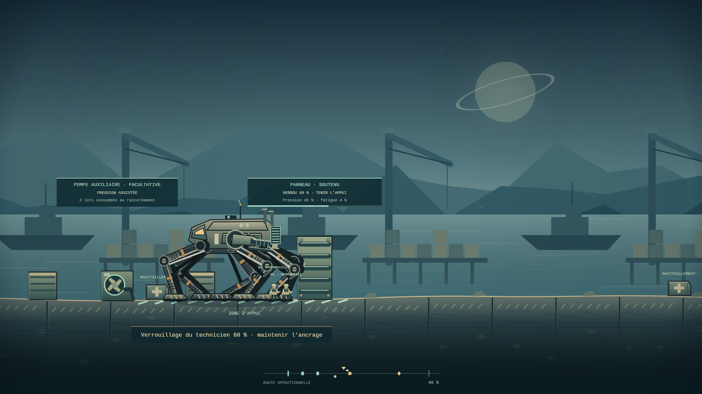

*Rendu Canvas de production, obtenu par commandes publiques ; les instruments HTML ne sont pas inclus. Ce n’est pas une capture navigateur.*

Le [contrat MI06](docs/CAMPAIGN_MISSION_06.md), le [dossier v6](docs/CAMPAIGN_SAVE_V6.md) et les [conséquences de Nacre](docs/NACRE_CONSEQUENCES_V08.md) décrivent les règles et leurs limites. MI07 et MI08 sont désormais jouables.

### Le chenal de MI05, conservé

La première mission de Nacre conserve la marée à quatre phases, les passerelles, les treuils, les deux barges à vérifier, le bateau de douze passagers et le dépôt facultatif de carburant. Elle distingue facture copiée, liaison avec Vann Ostre, arrivées et pertes. Aucun de ces constats locaux ne devient une preuve PALINODE. Son [contrat](docs/CAMPAIGN_MISSION_05.md) reste disponible.

## Vesper, conservé depuis la 0.5

### MI04 — Ce qui reste dans les filtres

Orison quitte une station après un rejet déclaré accidentel. Reprendre les installations demande de refroidir deux turbines, puis d’inspecter le journal du poste de maintenance. Le transport privé peut réellement se retirer : une fuite ne compte pas comme une destruction.

| Ce que Vesper a conservé | Ce qui change sur le terrain |
| --- | --- |
| Conduite intacte ou réparée | Le liquide est déjà disponible. Si elle reste rompue, brancher une pompe portative demande 5 secondes. Cela ne répare pas la conduite des maisons. |
| Au moins un ouvrier libéré du train | Son guidage ramène chaque manœuvre de refroidissement de 7 à 4 secondes. |
| Canal du dispensaire préservé | Un terminal permet un appel facultatif de 3 secondes. Seul l’appel effectué inscrit un témoignage. |
| Poste de maintenance préservé jusqu’à la lecture | Le journal copié devient PT01 : une pièce a été remplacée avant l’incident, sur ordre militaire. Le motif reste inconnu. |
| Journal détruit avant lecture | Le constat demeure possible et la mission reste terminable, sans preuve technique ; une autre source devra être recherchée plus tard. |

Une copie obtenue reste conservée si le poste est détruit ensuite. Remettre le dossier sous scellés ou joindre le constat au rapport change sa transmission, sans modifier les faits. Le bilan distingue journal, original, contact et compte rendu.

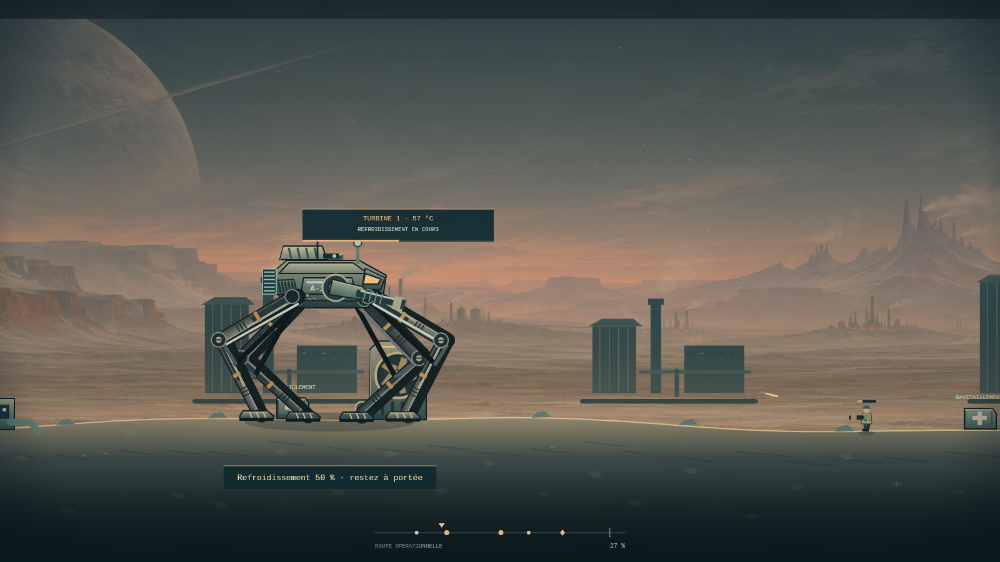

*Rendu du Canvas de production, obtenu par les commandes publiques avec le dossier historique migré. Ce n’est pas une capture navigateur et le HUD HTML n’y figure pas.*

### Une première avarie fonctionnelle

Le radiateur est localisé à l’arrière de chaque coque. Les projectiles qui l’atteignent réduisent sa santé et sa capacité de dissipation. Un tir frontal arrêté par la coque ne frappe pas le radiateur à travers elle. Le cockpit sépare température, intégrité du radiateur et refroidissement disponible, avec un minimum de dissipation de 35 %.

**T**, ou le bouton de réparation, restaure jusqu’à 60 points en quatre secondes. Le marcheur doit être immobile, tous les appuis posés. Marcher, tirer ou subir un impact interrompt le travail. Un kit n’est consommé qu’à la fin ; chaque nouvelle sortie en reçoit deux, et une reprise conserve le stock exact. Les caisses de munitions ne restaurent pas ce composant. L’atelier le remet en état contre des lots.

La coque visible suit maintenant son orientation, tandis que les contacts des pieds restent ceux de la simulation et la tourelle vise indépendamment. Une même règle de composant sur les ennemis reste à produire.

## Les acquis de la 0.4

### MI03 — Une fenêtre encore allumée

Trois émetteurs des Cales-Basses sont qualifiés de guidage hostile. Une source est bien militaire ; les deux autres desservent un dispensaire et des maisons occupées. L’ordre de Holt demeure une coupure générale.

- **Identifier sur place.** E lance le relevé à portée. Le relais militaire demande deux secondes, un bâtiment civil encore debout quatre. S’éloigner interrompt le travail. Le relevé d’un bâtiment vivant ferme la gaine de son terminal avant le passage des appuis.
- **Isoler la source militaire.** Une seconde interaction permet une coupure de deux secondes. La destruction reste possible, avec les risques ordinaires du combat.
- **Protéger des installations réelles.** Balles et explosions touchent les façades ; les appuis peuvent frapper une gaine exposée. Le passage devant le bâtiment est distinct de cette zone vulnérable. Sécuriser une gaine ne protège pas la façade contre les tirs.
- **Assumer le contrôle.** Six secondes cumulées de vérification civile déclenchent l’arrivée du drone de Holt. Il est absent du monde actif avant cet événement. Les combats aériens se déroulent dans une zone dégagée avant les maisons, permettant une approche sans dommage civil imposé.
- **Consigner ce qui reste.** Au terminal final, couper les circuits civils ou maintenir ceux qui fonctionnent. Le choix n’efface ni les dégâts ni les décès. Les ruines restent inspectables ; elles ne produisent pas des communications jamais relevées.
- **Conserver une conséquence précise.** Le dossier distingue zéro, un ou deux relais civils actifs, les habitants perdus, le dispensaire encore debout, le contrôle de Holt et la possibilité d’un contact ultérieur. MI04 permet désormais un appel facultatif par ce canal. La disponibilité du contact ne vaut pas un témoignage déjà recueilli.

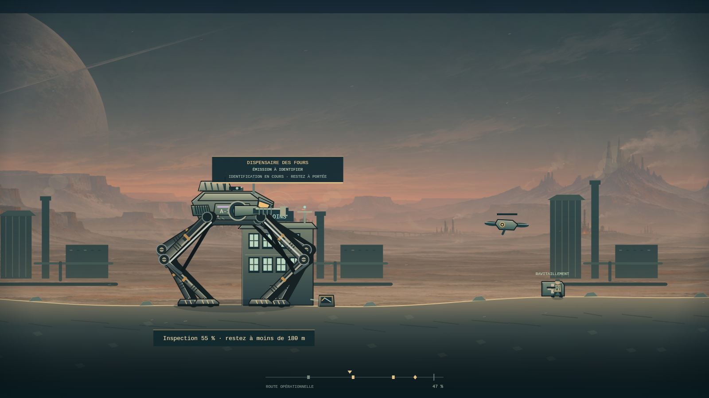

*Rendu du Canvas de production depuis une partie atteinte par les commandes publiques. Les menus et le HUD HTML sont absents ; ce n’est pas une capture navigateur.*

### Six châssis, des hauteurs et des cadences différentes

| Châssis | Appuis et profil | Comportement actuel | Magasin / réserve initiale |
| --- | --- | --- | --- |
| **M-12 Vigie** | 2, haut | Longue foulée, poste de tir élevé, coque intermédiaire. | 12 / 96 |
| **C-5 Caracal** | 2, bas | Pas courts rapides, refroidissement élevé, coque légère. | 20 / 160 |
| **Q-40 Bastion** | 4, bas | Diagonales alternées, blindage, progression lente. | 10 / 80 |
| **A-17 Arpenteur** | 4, haut | Grande enjambée, cabine élevée, longue durée de pas. | 12 / 96 |
| **H-6 Pèlerin** | 6, médian | Tripodes alternés, dissipation, large emprise. | 18 / 144 |
| **CL-4 Cloporte** | 6, très bas | Coque résistante, appuis courts, tir rasant. | 14 / 112 |

Le hangar conserve une même échelle d’affichage pour comparer les silhouettes. En mission, les articulations rejoignent les contacts réels de la simulation. Les aptitudes finales de déminage, tunnel, amphibie, transport de blessés et franchissement spécial restent à produire ; un châssis jouable ne les livre pas implicitement.

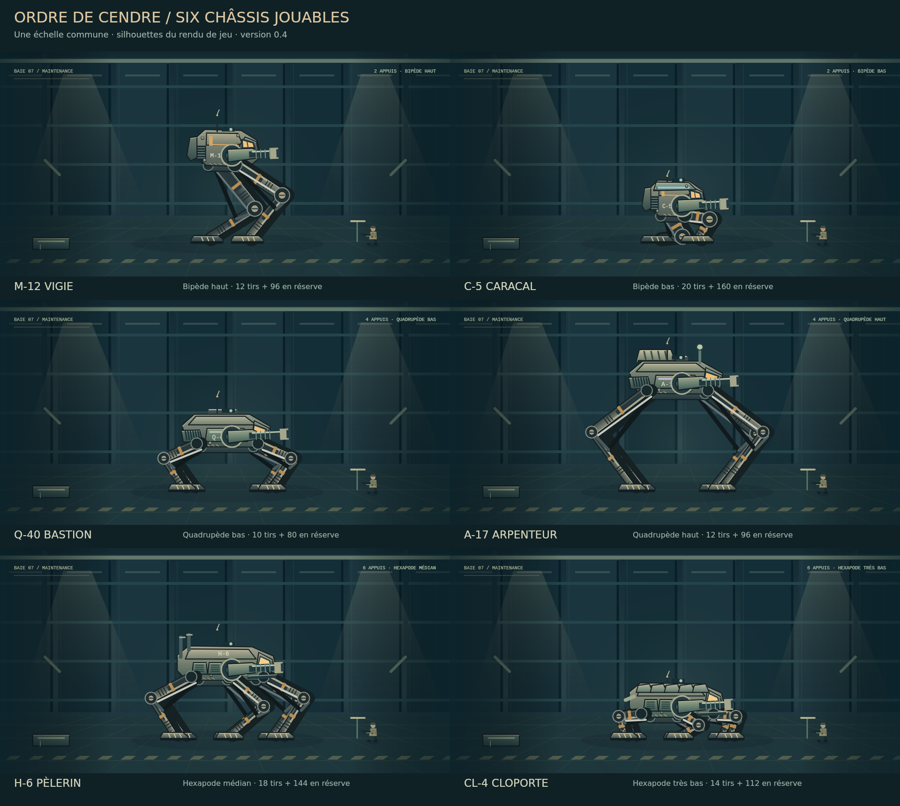

*Panneau composé des rendus du hangar de production, sans interface HTML. Ce n’est pas une capture navigateur.*

### Réserves finies et ravitaillement

Chaque départ donne un magasin chargé, **huit magasins en réserve** et le stock de roquettes propre au châssis. Recharger déplace les cartouches de la réserve vers les places libres. La dernière charge peut être partielle ; à réserve vide, R ne crée rien.

Une caisse ajoute au plus **trois magasins de réserve**, deux roquettes et une réparation, dans les plafonds prévus. Elle ne se collecte qu’une fois et garde cet état après sauvegarde. La chauffe et les pauses de rechargement conservent leur rôle : une réserve abondante n’autorise pas un tir continu sans ventilation. Le HUD distingue magasin, réserve et roquettes et signale l’épuisement.

Les réserves de munitions sont propres à chaque sortie. MI05 ajoute deux lots de carburant persistants lorsque le dépôt est réellement prélevé. MI06 peut consommer ces deux lots pour sa pompe auxiliaire ; les achats, livraisons et choix d’armement restent conçus pour la campagne complète.

## Les deux premières missions conservées

### MI01 — Le couloir quarante-deux

Escorter Sami et ses **24 caisses de filtres**. La première zone laisse découvrir les appuis. Près du treuil, déployer les dalles en 4,5 secondes protège une conduite fragile ; un contact de pied peut autrement la rompre. Le camion attend pendant l’intervention ou après l’incident.

L’embuscade oblige à protéger le convoi et à gérer tir, ancrage, chaleur et rechargement. Le manifeste n’est accessible qu’après livraison. Le rapport peut rester limité au bordereau officiel ou joindre le signalement des Cales-Basses. Le quartier ne reçoit pas automatiquement des filtres supplémentaires. La conduite et le signalement reviennent dans le dossier et les répliques de l’équipage.

### MI02 — La dette sous la poussière

Deux harpons retiennent un train de minerai sur un viaduc. Chaque treuil demande 2,5 secondes à portée. Libérer le second câble met le train en mouvement vers une voie rompue. Il faut rattraper la locomotive puis tenir la liaison de freinage quatre secondes.

Huit ouvriers sont enfermés dans un wagon. Les dégâts peuvent les tuer et détruire le registre de leur vente. L’ouverture et le relevé après arrêt conservent ce qui a effectivement survécu. Une copie déjà obtenue reste copiée ; des noms perdus ne sont pas inventés au rapport. Le dossier peut être remis scellé ou accompagné du constat signé.

Les trois premières missions de Vesper établissent des faits locaux. MI04 ajoute une première pièce technique, sans révéler prématurément la chaîne de preuves PALINODE.

## Dossier, atelier et migrations

Le dossier de campagne s’enregistre toutes les **huit secondes de simulation**, à la pause, au retour, avant et après la décision et lors des événements de fermeture disponibles. Le raccordement de l’auxiliaire et une défaite de MI06 à MI14 déclenchent aussi une sauvegarde immédiate. Une fermeture brutale peut revenir au dernier point effectivement écrit. Les opérations indépendantes gardent leurs rapports réussis, sans sauvegarde de leur partie en cours après fermeture.

Le **format courant est v14**. Les migrations contrôlées partent des fixtures historiques conservées ; les étapes v12 et v13 ajoutent les dossiers des deux missions reconstruites, puis v14 ajoute l’atelier de MI14. La migration conserve rapports, décisions, pièces, dégâts, phase et temps de rechargement. Les anciennes versions reçoivent les champs manquants : trois châssis neufs et une réserve documentée de huit magasins pour v1/v2, puis un radiateur neuf et deux kits pour chaque ancien checkpoint. Le dossier industriel commence sans preuve ni contact inventés. Un dossier v4 gagne uniquement Nacre non visité et zéro carburant ; tous ses checkpoints et ses quatre rapports sont conservés tels quels. Un dossier v5 gagne seulement la digue non visitée et un compteur de dépense nul ; même un transfert de carburant effectué dans une MI05 encore en cours ne crédite pas prématurément la réserve. Un dossier v6 gagne seulement l’ambulance non visitée, sans réécriture des six rapports ni du registre de carburant. Un dossier v7 gagne uniquement le volet d’Aval vide et le numéro de version v8 : les sept rapports et les scènes sanitaires restent exacts. Un dossier v8 gagne uniquement le volet de Thyr vide et le numéro de version v9, sans modifier ses huit rapports, ses scènes, son ancien stage ou ses ressources. Un dossier v9 gagne seulement `world.thyr.chemical` vide et la version v10 ; son ancien `stage`, ses neuf rapports, ses scènes et ses ressources restent exacts. Un dossier v10 gagne uniquement `world.thyr.voice` vide et le numéro v11 ; ses dix rapports, ses scènes et ses ressources restent exacts. La fixture v10 provient du pilote public figé de la 0.11, sans prétendre à une réception native. Un dossier v11 gagne le domaine `world.thyr.relay` vide ; le passage de v12 à v13 ajoute `world.kharon.foundry` vide. Les onze premiers rapports, les ressources et les scènes historiques restent conservés. La fixture v11 vient des exports publics historiques MI11 ; les nouveaux points v12 de reconstruction portent leur provenance distincte. La compatibilité des octets locaux perdus ne peut pas être certifiée sans leurs fichiers. La migration v13→v14 ajoute seulement `world.kharon.workshop` vide et conserve les treize rapports, les ressources et les anciens checkpoints. Les deux fixtures v13 proviennent des exports préparés et figés de la reconstruction 0.14.1. La lecture ne réécrit pas l’ancien fichier ; la première sauvegarde en conserve une copie de secours.

Une version future, un format étranger ou un fichier dépassant la taille admise reste protégé contre l’écrasement automatique, même avec une copie de secours lisible. L’import explicite ou la création d’un nouveau dossier est nécessaire pour le remplacer. Si le stockage refuse une écriture, la session reste jouable et l’interface indique l’échec.

L’atelier commence avec **six lots de pièces**. Chaque première réussite de MI01 à MI14 ajoute **quatre lots**, une seule fois. Réparer coque, appuis et radiateur coûte de un à six lots ; réparer la conduite coûte deux lots. Aucune intervention d’atelier n’est possible pendant la sortie officielle.

Une relecture ne remplace pas le premier rapport, ne redonne pas de dotation et n’efface pas la sortie officielle encore en cours. Réparer un service conserve l’incident dans l’histoire. Un rapport favorable ne restaure pas un bâtiment détruit après sa signature.

## Portée réelle et cible de production

| Domaine | Livré dans la 0.15.0 | Cible encore à produire |
| --- | --- | --- |
| Campagne | MI01–MI14, quatorze rapports, Vesper, Nacre, quatre missions de Thyr et deux sorties de Kharon. | 18 autres missions principales et 16 contrats. |
| Opérations indépendantes | Vesper : relais ; Nacre : escorte ; Thyr : ordre et adversaire lourd. | Campagnes des autres mondes et leurs règles propres. |
| Châssis | Six machines, deux profils par nombre d’appuis. | Six autres modèles, équipements et aptitudes spécialisées. |
| Combat | Tirs balayés, roquettes, ancrage, chauffe, appuis, radiateur localisé, composants du Prétoire, deux kits finis et réserves de munitions. | Familles d’armes complètes, composants des autres adversaires, doctrines d’escouade. |
| Monde et récit | Vesper et Nacre, route vivante, traitement chimique, Leth et relais de Thyr, convoi industriel et atelier en grève de Kharon. | Huit planètes complètes, neuf factions, coalition et quatre familles de fins. |
| Conception | 1 007 fiches, 21 onglets, 977 IDs précédents conservés, 30 fiches MI14 nouvelles et 133 critères initiaux. | Assets, voix, animations, niveaux, réglages et tests humains de production. |

Les statuts **Conçu**, **Prototype**, **À produire** et **Vérifié** restent distincts. Les fiches ne constituent pas un pourcentage d’achèvement. Les validations portent sur des scénarios et un environnement précis.

## Commandes

| Commande | Action |
| --- | --- |
| Q ou A / D, ou flèches gauche/droite | Reculer / avancer. |
| J / L | Alterner les groupes d’appuis en marche manuelle ; maintenir une direction. |
| Souris / clic gauche | Viser / tirer. |
| Clic droit | Tirer une roquette. |
| Espace | Ancrer. |
| V | Ventiler ; le tir s’interrompt pendant la purge. |
| T | Réparer le radiateur immobile en 4 secondes avec un kit. |
| R | Recharger depuis la réserve ; automatique à vide si des cartouches restent. |
| E | Lancer un travail ou une interaction proche, puis rester à portée. |
| Échap / F | Pause / plein écran. |

Onze actions clavier sont reconfigurables dans Réglages. Une manette standard peut piloter les missions : déplacement et visée aux sticks, RT pour tirer, LT pour ancrer, A pour interagir et Start pour la pause. Le panneau décrit la carte complète. Les menus et les choix utilisent le clavier ou la souris. Les boutons tactiles sont présents. Le confort sur matériel réel reste à valider. La hauteur de la machine change sa ligne de tir ; les bâtiments civils ne sont pas des cibles automatiques.

## Documentation

| Document | Usage |
| --- | --- |
| [Conséquences Vesper 0.5](docs/VESPER_CONSEQUENCES_V05.md) | Causalité, preuve, connaissance, composants, Nacre et critères de production. |
| [Concept complet 0.4](docs/CONCEPT_COMPLET_V04.md) | Tous les domaines : règles, contenu, récit, économie, art, accessibilité et production. |
| [Bible Excel](docs/ORDRE_DE_CENDRE_Bible.xlsx) | 21 onglets, 1 007 fiches ; source reproductible et critères de réception conservés. |
| [Bible générale](docs/BIBLE_FR.md) | Vision et règles communes. |
| [Campagne](docs/CAMPAIGN_FR.md) | Trente-deux missions, quatre actes et fins ; contient des révélations. |
| [MI01](docs/CAMPAIGN_MISSION_01.md), [MI02](docs/CAMPAIGN_MISSION_02.md), [MI03](docs/CAMPAIGN_MISSION_03.md), [MI04](docs/CAMPAIGN_MISSION_04.md), [MI05](docs/CAMPAIGN_MISSION_05.md), [MI06](docs/CAMPAIGN_MISSION_06.md), [MI07](docs/CAMPAIGN_MISSION_07.md), [MI08](docs/CAMPAIGN_MISSION_08.md), [MI09](docs/CAMPAIGN_MISSION_09.md), [MI10](docs/CAMPAIGN_MISSION_10.md), [MI11](docs/CAMPAIGN_MISSION_11.md), [MI12](docs/CAMPAIGN_MISSION_12.md), [MI13](docs/CAMPAIGN_MISSION_13.md), [MI14](docs/CAMPAIGN_MISSION_14.md) | Contrats du contenu réellement exécuté. |
| [Production 0.15](docs/PRODUCTION_V15.md), [reconstruction 0.14.1](docs/PRODUCTION_V14_RECONSTRUCTION.md) | Mission de l’atelier, provenance et travail restant ; conservation des 133 critères initiaux. |
| [QA 0.15](docs/QA_V15.md), [QA de reconstruction](docs/QA_RECONSTRUCTION_014.md) | Résultats de chaque version, avec portées distinctes de simulation, interface, rendu, classeur et navigateur. |
| [Sauvegarde v14](docs/CAMPAIGN_SAVE_V14.md), [v13 historique](docs/CAMPAIGN_SAVE_V13.md), [Architecture](docs/ARCHITECTURE.md), [API simulation](docs/SIMULATION_API.md) | Contrat courant de migration et références techniques historiques. |
| [Conséquences de Nacre](docs/NACRE_CONSEQUENCES_V09.md), [commandes et son](docs/CONTROLS_AUDIO_V09.md) | Personnes, capacités, arrivées, héritages et commandes disponibles. |
| [Lots graphiques et audio](assets/production/README.md), [Thyr](assets/thyr/README.md), [champ chimique](assets/chemical/README.md), [voix de Thyr](assets/voice/README.md), [relais](assets/relay/manifest.json), [fonderie](assets/foundry/manifest.json), [atelier](assets/workshop/manifest.json) | Géométries originales, variantes SVG, planches PNG et exports audio, avec leur provenance. |
| [Direction artistique](docs/ART_DIRECTION.md), [provenance](docs/ASSET_PROVENANCE.md) | Art, animation, sons et origine des éléments. |
| [Déploiement](docs/DEPLOYMENT.md) | Construction web, liaison distante et état réel de publication. |
| [Données source](data/bible.json) | Les 1 007 fiches à identifiants stables, dont les 977 IDs précédents conservés. |

## Vérification et prochaine étape

Le [rapport QA de la 0.15](docs/QA_V15.md) rassemble les résultats exécutés sur cette tranche : simulation, dossiers, interface, dessin, classeur et navigateur. Les [preuves de reconstruction](docs/QA_RECONSTRUCTION_014.md) et les manifestes de production antérieurs gardent leur environnement et les empreintes de leurs sources. Une réception historique ne certifie pas les nouveaux fichiers.

La source du classeur contient **1 007 fiches**, soit **30 ajouts aux 977 fiches précédentes conservées**. Les statuts indiquent des niveaux de conception ou de réception ; ils ne certifient pas la finition du jeu. La prochaine mission conçue est **MI15 — Sous le même numéro**. Les dix-huit missions restantes, les seize contrats, les six autres châssis, les composants des autres ennemis et les essais humains demeurent au registre.

### Réception historique de la 0.12

La [validation 0.12](docs/QA_V12.md) rassemble **516 tests Node réussis et 86 parcours d’interface dans un DOM modélisé** sur MI11 et les régressions des versions précédentes. La simulation dédiée vérifie 35 cas MI11, dont douze sorties complètes avec les six châssis et les deux conduites. Les 25 scènes Canvas proviennent de dix-huit sorties par commandes publiques et conservent cinq exports préparés. La comparaison SVG/Canvas porte sur 90 variantes.

Le classeur rassemble **905 fiches sur 21 onglets**, soit 32 ajouts. Les 873 identifiants précédents et les 133 critères initiaux restent conservés. Le [guide du classeur](docs/BIBLE_README.md) et le [registre de production](docs/PRODUCTION_REGISTER_V12.md) détaillent les preuves de réception.

La [réception partielle dans Chrome](docs/validation/native-v12/production-reception.json) distingue les migrations v9/v10 vers v11, l’essai d’écoute et la continuation depuis un **checkpoint d’échange préparé à 45 %**. Avec le **Pèlerin WK09, en difficulté Normal avec les aides actives**, le témoignage, le choix de remise en service, le retour physique à l’émetteur, les cinq secondes de travail, le rapport et l’extraction ont ensuite été accomplis dans le navigateur. Le résultat reçu à **05:47** conserve **11 rapports, 50 lots, Leth vivant, les trois sites intacts et aucune perte civile**. Les [deux exports finaux](docs/validation/native-v12/production-verification.json) sont identiques après rechargement. Cette réception porte sur des séquences déclarées, sans revendiquer une mission entière depuis son début ni un essai humain ; QA19, QA20 et QA29 restent ouvertes.

Le [constat natif avant publication](docs/validation/native-v12/browser-reception.json) reste conservé avec son état historique `not_run`. Le quota de l’ancienne demande explicite 0.11 n’a pas empêché le déploiement automatique 0.12 reçu. Les nouvelles observations de production disposent de leurs propres preuves.

Cette réception 0.12 précède la reconstruction de MI12 et MI13. Ses comptes et ses captures conservent cette portée historique.

### Réceptions historiques conservées

La version 0.10 passe **356 tests Node, 66 parcours d’interface dans un DOM modélisé et 40 comparaisons raster SVG/Canvas**. La matrice MI09 vérifie les six châssis et les deux routes ; les 34 tests de dossier v9 contrôlent migrations, reçus, dégâts, pertes, reprises et rejeux. Les 22 vues de Thyr viennent de 17 sorties pilotées par les commandes publiques. La [validation 0.10](docs/QA_V10.md) distingue chaque famille de preuve.

La [réception native 0.10 dans Chrome](docs/validation/native-v10/browser-reception.json) vérifie aussi la migration du vrai dossier v8 et la reprise de checkpoints préparés de Thyr. Le briefing, la décision, le HUD et le bilan ont été observés aux zooms déclarés, jusqu’à 150 %. Après extraction au clavier puis recharge, le journal conserve les neuf rapports et l’atelier affiche 42 lots. Les exports après extraction et recharge sont identiques octet par octet ; **87 contrôles** rapprochent les quatre fichiers de cette séquence. Un cinquième export conserve la sortie utilisée pour le focus. Cette séquence ne vaut pas partie humaine complète. QA19 reste ouverte à cause de résultats de focus différents selon l’instance ; QA20 attend encore une petite fenêtre native réellement mesurée, et QA29 une réception bureautique interactive.

La première publication 0.10 a passé la CI sur son commit exact et la comparaison de 18 ressources publiques avec le snapshot livré. Les reçus initiaux sont conservés ; les quatre libellés de navigation corrigés et les nouvelles preuves natives font partie de la livraison finale décrite dans le [suivi de publication](docs/DEPLOYMENT.md).

La livraison 0.9 conservait **291 tests Node et 57 parcours d’interface**. L’audit indépendant de MI08 couvre **32 variantes, 8 915 sauvegardes suivies de réimportation, 8 915 restaurations exactes et 795 continuations déterministes**. La [validation 0.9](docs/QA_V09.md) conserve les résultats exécutés sur les sources livrées et distingue simulation par commandes publiques, migrations historiques, DOM modélisé, rendus Canvas, classeur et navigateur réel. La matrice MI08 couvre les six châssis et les trois conduites ; les avaries et les héritages sanitaires sont des variantes séparées. Une source perdue ne crée pas de preuve ; un départ ne compte pas comme une arrivée ; une relecture ne modifie pas le premier dossier.

Lors de la 0.9, Chrome a reçu la migration du dossier réel v7, les imports valides et invalides, la reprise de MI01, une poursuite et un freinage de MI02, les relectures, le remappage clavier et la continuation de MI08 depuis sa porte partielle. Le résultat conservé compte 34 personnes au refuge, deux à Aval, quatre patients arrivés et aucun perdu ; les sept rapports antérieurs restent intacts. Le [rapport navigateur 0.9](docs/validation/v09-browser.json) déclare les points préparés, les dimensions et chaque limite. Les deux essais natifs 0.9 de perte de focus avaient laissé continuer la marche. Les corrections 0.10 et leur réception séparée sont consignées dans QA_V10.md. La petite fenêtre native, la manette physique et l’écoute humaine ne sont pas déclarées reçues.

La continuation native MI07 de la version 0.8 reste conservée dans son [rapport historique](docs/QA_V08.md) avec sa portée d’origine.

L’adresse du site est [imperium-march.vercel.app](https://imperium-march.vercel.app/). Le [suivi de publication](docs/DEPLOYMENT.md) identifie le commit distant, le déploiement exact, la date du contrôle HTTP, l’état de la CI et les observations de navigateur effectivement réalisées. Les captures Canvas restent distinctes de ces observations.

Les prochains chantiers comprennent MI14 et la suite de Kharon, les contrats encore conçus, les six autres châssis et la finition des missions de référence. Les voix, l’animation finale, les essais humains et les performances sur matériel déclaré gardent leurs critères dans le registre de production.
