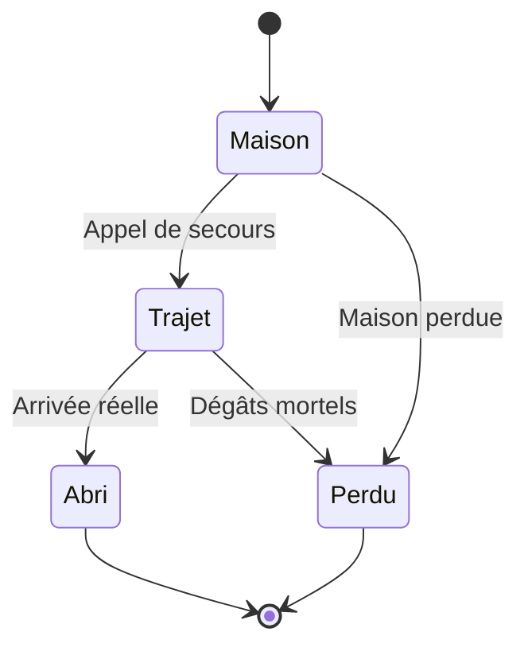

# Nacre — Tenir la digue, compter les personnes

**Contrat de campagne 0.7.0 · 11 novembre 2026**

MI05, **Le prix du passage**, et MI06, **Les maisons sous la ligne**, forment les deux premières sorties jouables de Nacre au stade prototype. MI07 et MI08 restent conçues. Le présent document sépare les conséquences déjà consommées dans MI06 des contrats de réalisation de la suite. La [version 0.6](NACRE_CONSEQUENCES_V06.md) conserve l’état de conception précédent.

La digue donne un autre usage à la machine d’occupation : tenir pendant que des personnes accomplissent un travail. Ce geste ne suffit pas à juger le résultat. Un panneau peut être sécurisé pendant qu’une maison devient inhabitable. Des habitants peuvent atteindre l’abri sans retrouver leur logement. Le rapport conserve ces faits séparément.

## 1. Ce qui vient réellement du chenal

Le premier rapport de MI05 débloque MI06. Un bateau perdu, une facture détruite, un contact absent ou une réserve ignorée ne bloquent pas l’accès. PT01 reste une source de Vesper, sans rôle de clé d’entrée à la digue.

| Héritage | Effet actuel dans MI06 | Limite de sens |
| --- | --- | --- |
| Chenal ouvert et passagers effectivement arrivés | Les techniciens empruntent l’accès par le quai. | Les réfugiés ne deviennent pas ces techniciens. |
| Passage sans arrivée civile | Les techniciens utilisent une entrée plus éloignée, par la passerelle haute. | Les pertes du chenal demeurent au dossier; l’autre route ne les annule pas. |
| Deux lots de carburant encore disponibles | Une pompe auxiliaire peut être branchée. | Il faut accomplir le branchement et payer le coût. |
| Réserve absente ou déjà dépensée | Le chantier conserve une voie manuelle. | La progression ne crée aucun lot de remplacement. |
| Facture, contact avec Vann et pertes de Rive-Courte | Le dossier garde ces faits de MI05. | Ils n’attribuent ni nouvelle preuve PALINODE ni présence de Vann au chantier. |

Les techniciens sont deux intervenants de la régie. Les dix habitants occupent deux maisons de la digue. Ces populations ne sont ni les douze passagers du bateau de MI05 ni les quatre membres de Rive-Courte. L’archive doit permettre de retrouver chaque bilan dans sa mission d’origine.

## 2. MI06 : personnes, structures et voix

### Deux maisons, dix habitants

La première maison abrite six personnes, la seconde quatre. Chacun possède une position, une intégrité et un état de déplacement. Après un premier constat de maison, l’appel radio demande à Mara le départ de tout le quartier encore vivant. Il n’accorde aucun sauvetage au moment où le joueur presse la commande. Les deux inspections restent nécessaires pour établir le relevé préalable au choix de circuit.

Les personnes rejoignent l’abri à l’ouest du quartier. Elles peuvent attendre face à une menace, subir un projectile pendant leur trajet ou atteindre réellement l’abri. Les personnes arrivées sortent des collisions. La destruction ou l’inondation d’une maison tue seulement ses occupants encore à l’intérieur; elle ne rappelle pas ceux déjà partis.

À chaque instant, les habitants à la maison, en trajet, à l’abri et perdus représentent ensemble les dix personnes initiales. Une personne ne peut pas être comptée simultanément comme arrivée et morte. Le premier rapport conserve le total à l’abri et les pertes lorsque le sort des dix habitants est établi.

### Deux techniciens et de vrais abris

Les techniciens disposent d’une position, de leur santé et d’une progression propres. L’appel au poste du génie lance leur déplacement. Les menaces locales peuvent les faire attendre à couvert. Deux abris destructibles interceptent les projectiles : leur fonction appartient aux collisions de la simulation.

Un technicien vivant arrivé au poste peut aider au verrouillage et aux travaux de vanne. Un intervenant perdu ne réapparaît pas dans une animation de chantier. Si les deux sont perdus, une opération manuelle conserve une issue, avec un travail plus long. Le pilote ne peut pas remplacer ces morts par les habitants qu’il vient de secourir.

### Mara intervient à la radio

Mara Eren, PN07, parle depuis une liaison locale après inspection réelle des seuils. La version 0.7 ne représente pas Mara comme un personnage physique exposé aux tirs. Sa voix ne constitue ni un recrutement, ni un nouveau témoignage politique, ni un accord pour toutes les missions futures.

Son rôle est de rendre le constat précis : ces maisons sont occupées, le niveau prescrit les menace, les personnes et leurs logements n’ont pas le même sort. Une radio disponible n’autorise pas un récit omniscient de tous les actes de Sera. Les scènes ultérieures devront établir les informations qu’elle reçoit effectivement.

## 3. Le soutien ne se confond pas avec la réparation

Le panneau possède son intégrité, son état de soutien temporaire, un verrou et une possibilité d’étai de secours. Le soutien demande une position de travail, l’immobilité, l’ancrage et tous les pieds posés dans la bande d’appui prévue. La présence du marcheur à proximité ne suffit pas.

Quand les conditions disparaissent, le soutien cesse. Tant qu’un technicien termine le verrou, le joueur doit tenir la position. Le verrou achevé libère cette contrainte. Une machine n’est donc pas obligée de rester éternellement devant un panneau dont le travail est terminé.

La perte des techniciens ouvre le repli manuel. Un étai de secours peut aussi rendre le passage exploitable après destruction du panneau. Ce résultat ne restaure pas sa coque et ne doit pas être décrit comme un panneau intact. Le dossier distingue **panneau verrouillé** et **étai de secours**.

La pompe auxiliaire retient une partie de la pression et réduit l’usure pendant le chantier. Elle accélère le travail d’étai. Si elle est détruite après branchement, son avantage cesse. Le carburant utilisé reste dépensé. Le joueur peut donc avoir payé une aide qu’un dommage ultérieur lui fait perdre.

Les réglages numériques et durées de cette tranche figurent dans le [contrat MI06](CAMPAIGN_MISSION_06.md). Ils définissent un dispositif local de référence. Ils ne livrent pas un modèle général de résistance de tous les quais de Nacre.

## 4. Choisir le circuit, puis l’exécuter

Le choix s’ouvre après les deux inspections et la sécurisation du panneau. Il prépare un circuit impérial ou une dérivation. La simulation reprend ensuite et le joueur doit encore manœuvrer la vanne.

| Circuit | Travail matériel | Effet sur le quartier |
| --- | --- | --- |
| Réglage impérial | Manœuvre de vanne plus courte. | L’eau monte derrière les maisons; lorsqu’elle atteint le seuil, les logements deviennent inhabitables. |
| Dérivation locale | Manœuvre plus longue. | Le niveau bas est maintenu et les logements encore debout sont préservés de cette inondation. |

Un technicien vivant arrivé facilite le travail. Sans lui, la durée manuelle s’applique. La décision ne met pas automatiquement les pompes en service et n’évacue personne. La dérivation ne répare pas une maison détruite auparavant par des tirs. L’ordre impérial n’annule pas les départs déjà réalisés.

La montée d’eau est observée après l’activation du circuit impérial. L’extraction ne doit pas permettre de partir avant que la conséquence sur les logements ait été établie. Les habitants doivent eux aussi avoir un sort déterminé. Le résultat reste donc lié au monde, même lorsque le joueur a déjà choisi une ligne de rapport.

## 5. Le carburant : stock, dépense et archive

La 0.6 conservait deux lots facultatifs de MI05. La 0.7 leur donne un usage local dans MI06. Le branchement accompli consomme les deux lots; commencer le travail puis l’interrompre ne les dépense pas.

Trois informations doivent rester distinctes :

| Information | Question à laquelle elle répond |
| --- | --- |
| Stock actuel | Combien de lots sont encore disponibles pour un nouveau départ ? |
| Dépense cumulée de Nacre | Combien ont déjà été engagés dans les tentatives officielles ? |
| Dépense de la sortie archivée | Combien ont été engagés pendant cette sortie précise ? |

La campagne inscrit la dépense dès le branchement effectif d’une sortie officielle. Une défaite, un retour au menu ou un nouveau départ ne recrée pas les lots. Il ne faut pas attendre un rapport victorieux pour rendre cette dépense persistante.

Le point avant décision reste dans l’archive de reprise. Dans MI06, il n’est plus restaurable dès qu’il précède l’horloge officielle courante, même à coût identique. La reprise du point courant conserve le chantier exact. Si l’écriture locale échoue, l’interface signale ce refus : une sauvegarde refusée ne doit pas être présentée comme enregistrée.

### Exemple de deux tentatives officielles

| Moment | Stock actuel | Dépense cumulée | Dépense de la tentative active |
| --- | ---: | ---: | ---: |
| Premier départ avec la réserve de MI05 | 2 | 0 | 0 |
| Branchement achevé | 0 | 2 | 2 |
| Tentative perdue | 0 | 2 | 2 |
| Nouveau départ | 0 | 2 | 0 |
| Sortie suivante terminée par la voie manuelle | 0 | 2 | 0 |

Le rapport de la sortie réussie peut donc indiquer zéro carburant utilisé, tandis que l’atelier indique deux lots déjà dépensés. Cette différence décrit l’histoire des tentatives. Elle n’est pas corrigée en réécrivant le rapport ou en remboursant la réserve.

Une **relecture** utilise un état simulé isolé. Ses branchements, pertes et résultats ne modifient ni stock, ni registre, ni premier rapport officiels. Ce contrat est différent d’un recommencement de la sortie officielle en cours.

La migration d’un vrai dossier v5 ajoute la digue non jouée et un registre de dépense nul. Elle conserve la réserve réellement obtenue à MI05. Elle ne simule pas une consommation passée. L’économie commerciale, les achats de carburant et l’approvisionnement permanent restent à produire.

## 6. Ce que MI06 laisse dans le dossier

Le bilan conserve les deux inspections, l’appel de secours, les habitants arrivés et perdus, les logements inhabitables, les techniciens vivants et perdus, le verrou ou l’étai, la fatigue du panneau, le circuit, les pompes et le carburant de la sortie. La dépense cumulée demeure un état de campagne distinct.

Les combinaisons suivantes ont un sens et ne doivent pas être simplifiées :

- **Dix habitants à l’abri et deux logements perdus.** Le secours a réussi; le quartier n’est pas préservé.
- **Aucun carburant employé dans la sortie réussie, deux lots déjà dépensés.** Une tentative précédente a engagé la réserve.
- **Étai de secours et panneau détruit.** L’accès est assuré par un repli, sans réparation fictive du panneau.
- **Pompe auxiliaire branchée puis détruite.** La dépense existe, l’aide actuelle n’existe plus.
- **Habitants sauvés et techniciens perdus.** Ce sont des personnes et des métiers différents.

Ces états décrivent un chantier. Ils ne donnent aucun nouveau PT ou PO à la chaîne PALINODE. Le constat local peut nourrir une enquête future, à condition d’être recoupé dans une scène à produire.

## 7. MI07 — Contrat de suite encore conçu

**Une ambulance sans escorte** se déroule sur la chaussée des Salines. Holt transmet une signature de dépôt mobile de munitions. Sera rejoint un véhicule sanitaire et doit établir ce qu’il transporte. Le marquage hostile ne prouve pas à lui seul la présence d’armes.

### Consommer l’état de MI06

La cible de réalisation distingue service utilisable et bâtiment épargné. Des pompes en service ne signifient pas que toutes les maisons sont habitables. Avant d’ouvrir le niveau, il faut choisir dans la scène un lieu d’arrêt et un lieu d’accueil qui correspondent à l’état réel de la digue.

Le verrou ou l’étai, la fatigue du panneau et les techniciens survivants fournissent des différences réellement conservées. La cible de MI07 utilise la rampe principale lorsque son appui est fiable; un étai de secours ou une fatigue trop élevée impose une rampe secondaire, avec un trajet plus long à protéger. Le seuil de charge devra être annoncé avant l’engagement du véhicule. Un technicien vivant peut proposer une aide après un échange, sans obligation créée par la seule sauvegarde. Cette alternative n’utilise pas du carburant déjà consommé. Aucun stock n’est donné par la transition.

Les dix habitants précédents ne deviennent pas automatiquement les patients du véhicule. L’ambulance présente son conducteur, son personnel et ses passagers. Le dossier crée leurs identités et nombres au moment où la mission les introduit.

### Interactions et variantes à produire

L’interception demande un appel, une aire d’arrêt dégagée et une arrivée du véhicule. L’examen suppose l’arrêt et l’accord de son responsable. Le relevé compare la caisse sanitaire avec un boîtier récemment fixé sous le châssis.

Le démontage de la balise préserve ses attaches et son journal quand le travail est accompli. Une balise détruite ne fournit pas le même relevé. Des drones de saisie arrivent selon un signal annoncé; leur provenance ne se déduit pas d’un seul symbole. Le transfert sanitaire exige une rampe, une voie praticable et un accueil disponible.

La perte du véhicule, d’un soignant ou de la balise doit donner une issue de constat. Il ne faut pas placer un objectif d’inspection impossible sur une source déjà détruite. Patient arrivé, personnel vivant, véhicule récupéré, balise obtenue, provenance recoupée et consentement à témoigner ont des états distincts.

### Répliques de conception

**Conductrice :** « Sous le portique, je peux m’arrêter. Ici, chaque joint soulève le brancard. »

**Tess :** « Les fixations sont neuves. Laissez-moi lire le boîtier avant de le couper. »

**Mara, si le relevé lui est effectivement transmis :** « Gardez la balise. Les noms des patients restent sur le dossier de soins. »

Ces textes sont des propositions pour une mission conçue. Ils ne sont ni des dialogues joués, ni des voix enregistrées. Mara ne peut pas recevoir le résultat par simple supposition du scénario.

## 8. MI08 — Contrat de sortie de Nacre encore conçu

**La marée compte les absents** met en jeu les portes d’Aval. La première contrôle l’admission d’eau; la seconde le passage des bateaux. Ouverture, pression, fatigue, dégâts et manœuvre appartiennent à chaque porte séparément.

Les services de MI06 déterminent les zones qui restent utilisables pour préparer les départs. Les logements perdus déterminent un besoin de relogement, sans créer de nouveaux morts. Les personnes présentes et vivantes doivent être retrouvées dans une scène explicite. Les ressources engagées à MI06 ne sont pas réattribuées pour rendre le départ plus simple.

MI07 doit apporter ses propres patients, soignants et moyen de transport selon leur état et leur accord. Vann peut être sollicité s’il est vivant et disponible; son aide à MI05 ne constitue pas une promesse de revenir. Les douze passagers du chenal, les dix habitants de la digue et les personnes de l’ambulance gardent des origines séparées.

Avant le choix, chaque bateau annoncé doit avoir un état, une capacité et une destination. Le refuge doit être présenté avec un responsable et un accueil possible. Une personne sortie de l’archipel n’est pas nécessairement déjà arrivée au refuge. Les départs observés restent acquis lorsqu’une porte se ferme ensuite.

La fermeture immédiate, une fenêtre de départ retardant la fermeture et le maintien d’un accès produisent des conséquences matérielles. La déclaration à Holt vient rendre compte de ces actes. La désobéissance locale de Nacre ne remplace pas la défection opérationnelle de MI16.

**Mara, si elle est présente et attend encore des patients :** « Il reste un brancard sur le quai. Gardez la porte ouverte jusqu’à ce qu’il soit à bord. »

**Vann, s’il a accepté la traversée :** « J’ai une sortie à la renverse. Après, je ne vous promets plus ce chenal. »

Ces scènes, les deux portes et leurs tests restent à produire.

## 9. Travail ouvert et preuve de livraison

Les contrats CT03 et CT04 restent conçus. Le premier prépare un itinéraire de nuit; le second éprouve les intérêts de Vann. Aucun ne doit cacher l’unique preuve nécessaire à une fin viable derrière une activité facultative.

Le prototype de MI06 ne clôt pas la finition des personnages, de l’eau, des bâtiments, de l’audio ou du HUD. La compréhension du soutien, des travaux après décision et du carburant demande un essai humain séparé des scripts. QA115 garde cette exigence ouverte.

Le [plan de production 0.7](PRODUCTION_V07.md), le [contrat MI06](CAMPAIGN_MISSION_06.md) et les preuves de validation précisent ce qui a réellement été exécuté. Une capture Canvas, un test de simulation et un parcours navigateur n’ont pas la même portée.
