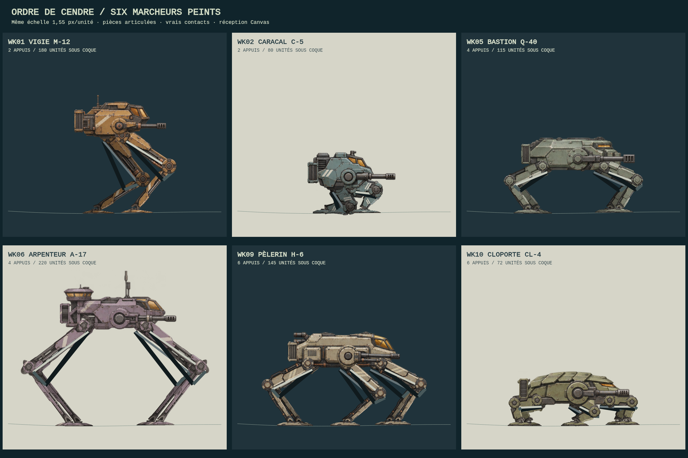

# Production 0.15.3 — Les six marcheurs peints

**ORDRE DE CENDRE · 16 novembre 2026 · Tranche de production graphique**

Cette livraison ajoute les pièces peintes articulées des six marcheurs déjà jouables. Elle poursuit les lots de l’atelier MI14 et du combat générique. Le jeu conserve **MI01–MI14, six châssis, trois opérations indépendantes et les sauvegardes v14**.

## Livraison

| Lot | Atlas originaux | Cellules |
| --- | ---: | ---: |
| Atelier MI14, conservé | 8 | 54 |
| Acteurs et véhicules de combat, conservés | 9 | 78 |
| Six marcheurs, nouveau | 6 | 96 |
| **Total peint** | **23** | **228** |

Les nouveaux PNG mesurent **1 254 × 1 254 pixels**, avec vrai fond transparent et grille de quatre lignes par quatre colonnes. Chaque planche contient huit familles de pièces et leurs états : coque, tourelle/canon, segment supérieur, segment inférieur, hanche, genou, pied et radiateur. Les 96 cellules sont toutes utilisables dans le rendu ; elles ne représentent ni 96 machines ni 96 cycles complets de marche.

Vigie conserve sa cabine haute et son ocre ; Caracal sa silhouette compacte bleu pétrole ; Bastion sa casemate lourde sauge ; Arpenteur sa nacelle mauve et ses très longs membres ; Pèlerin sa coque d’endurance grès ; Cloporte son toit segmenté olive et sa faible garde au sol.

Les [originaux, prompts et mesures](../assets/painted/walkers/README.md) sont livrés avec le code. Les fichiers PNG sélectionnés restent identiques aux sorties de génération. Le script d’indexation produit seulement les rectangles, cadrages, ancres et manifeste.

## Comportement intégré

La simulation continue de décider de chaque position de pied, phase d’appui, jambe touchée et visée. Le renderer assemble les pièces autour des hanches, genoux et chevilles existants. Les canons restent des pièces indépendantes, avec leur bouche physique et la dispersion inchangée. Les vérins gardent leurs liaisons dynamiques.

Les variantes de dégâts de coque, segments et chaussures suivent les valeurs de santé. L’ancrage sélectionne ses cellules de coque et de pied. Les radiateurs reçoivent les états statiques intact, endommagé et réparé ; l’impact bref et la réparation progressive gardent leur rendu vectoriel.

Les pièces lointaines sont assombries au rendu. Les atlas sont employés également au hangar. En cas d’image indisponible, le repli vectoriel reste disponible. Le boss Cerbère conserve son rig propre, et les exports SVG historiques sont inchangés.

*Banc Canvas avec les vrais appuis des états initiaux et un placement de comparaison. Cette image ne constitue pas une capture de navigateur.*

## Vérification

Le [rapport QA](QA_PAINTED_WALKERS.md) reçoit les **96 cellules**, les ancres, les bouches, les semelles, l’ordre de profondeur et le repli après erreur. Il présente un banc, **54 poses de contrôle**, six scènes simulées et six hangars. Les états d’avarie et de réparation imposés pour l’inspection sont explicitement des copies de diagnostic.

Les contrôles globaux de simulation, catalogue, interface, SVG/Canvas et construction sont consignés dans ce rapport. L’édition autonome contient **39 modules et les 23 atlas**, sans téléchargement complémentaire. La publication distante est reçue séparément dans le [suivi de déploiement](DEPLOYMENT.md).

## Bible et suite

La [Bible Excel](ORDRE_DE_CENDRE_Bible.xlsx) conserve **1 007 identifiants, 21 onglets, 126 formules et tous ses statuts**. Dix-huit fiches enregistrent le lot et ses limites. Les 133 critères initiaux sont préservés ; les détails de comparaison, formules et aperçus sont dans le [complément Bible](BIBLE_V15_3.md).

Le lot reste **Prototype**. Les cycles finaux, transferts de masse, changements de hauteur, rechargements et recul, aptitudes spécialisées et flotte complète de douze châssis restent à produire ou à recevoir. Les variantes de factions, la diversité civile, la faune, les biomes et MI15–MI32 conservent leurs travaux propres. Cette tranche complète un manque visible de l’ensemble jouable ; elle ne clôt pas la production du jeu.
