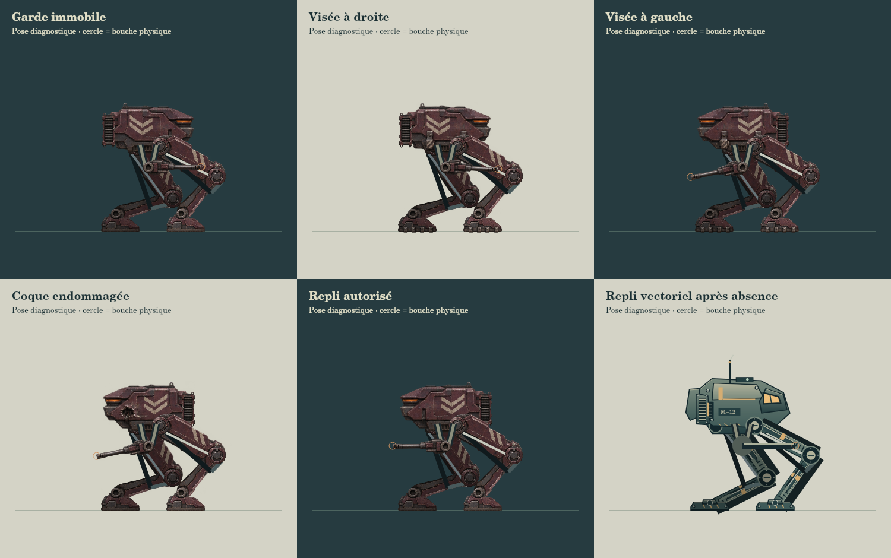
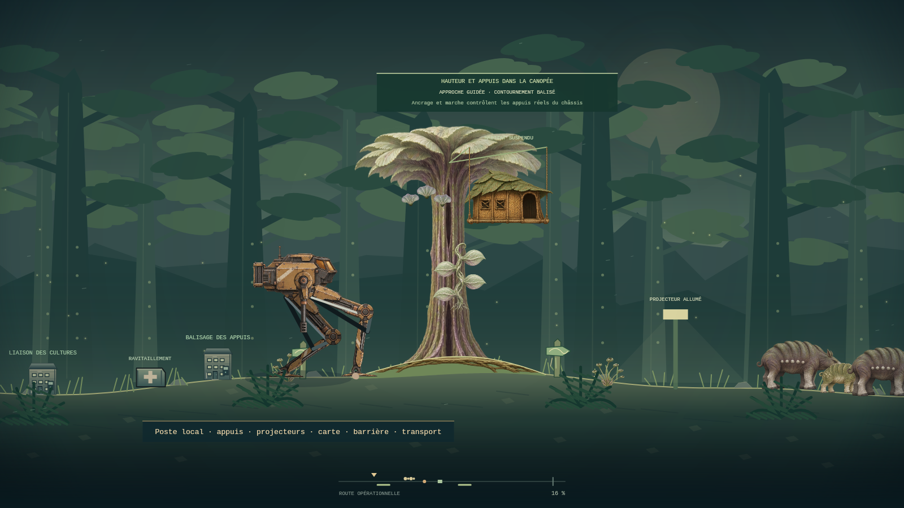

# Production 0.15.4 — Cerbère et vie de Thyr

**ORDRE DE CENDRE · 16 novembre 2026 · Tranche de production graphique intégrée**

Cette livraison ajoute **neuf atlas originaux, 78 cellules**, consacrés aux sujets déjà actifs qui restaient vectoriels : Cerbère, les Longues-dorses adultes et jeunes, les Éventails, le Guetteur-racine, les colonnes-mères, habitats, racines, plantes et Leth. Elle reprend la 0.15.3 fusionnée, sans refaire ses six marcheurs peints.

## Livraison réelle

| Lot | Atlas | Cellules |
| --- | ---: | ---: |
| Atelier MI14, conservé | 8 | 54 |
| Combat générique, conservé | 9 | 78 |
| Six marcheurs, conservés | 6 | 96 |
| Cerbère, nouveau | 1 | 16 |
| Vie de Thyr, nouveau | 8 | 62 |
| **Total peint** | **32** | **306** |

Le nouveau lot comprend **69 cellules adressables au rendu et neuf références**. Ce sont des pièces, poses et états, sans nouvel effectif. Les [neuf originaux](validation/release-v0154/generated-originals.json) ont été comparés octet par octet aux sorties de génération. Aucun PNG n'a été retouché, redimensionné ou rééchantillonné après génération. Les scripts mesurent seulement les sources et produisent les métadonnées.

| Fichier | Cellules | Intégration |
| --- | ---: | --- |
| `assets/painted/cerbere/cerbere.png` | 16 | Coques, canon et pièces articulées propres au boss |
| `assets/painted/thyr/rootwatcher.png` | 12 | Repos, huit pas, préparation et attaque; mort en référence |
| `assets/painted/thyr/longuedorse-adult.png` | 8 | Attente, quatre pas, arrivée, exclusion vivante et perte |
| `assets/painted/thyr/longuedorse-young.png` | 8 | Même contrat pour les deux jeunes existants |
| `assets/painted/thyr/fan-colony.png` | 6 | Colonie posée, quatre poses de vol et perte |
| `assets/painted/thyr/column.png` | 6 | Deux silhouettes, chacune intacte, endommagée et détruite |
| `assets/painted/thyr/habitat.png` | 6 | Trois états d'habitat et trois états de racine |
| `assets/painted/thyr/plants.png` | 8 | Vigne et Herbe d'écho; herbe aplatie en référence |
| `assets/painted/thyr/leth.png` | 8 | Six poses couvrant cinq états, plus deux outils de référence |

Les [guides Thyr](../assets/painted/thyr/README.md) et [Cerbère](../assets/painted/cerbere/README.md) détaillent dimensions, prompts, cadrages, empreintes et usages. L'atlas des habitats possède des rangées inégales, explicitement mesurées; aucune coupe n'utilise une grille supposée qui traverserait les maisons.

## Cerbère et cohérence du tir

Cerbère garde son rôle dans OP03. Son canon, le télégraphe et le départ du projectile partagent maintenant la pose du tir existant : pivot au centre physique de l'ennemi, bouche à `w / 2`, soit **89 unités**. Le canon peint est une pièce séparée reliée à la coque par un support ventral. Origine, vitesse, dégâts et règles de garde/repli sont conservés.

Ses jambes restent un **rig de présentation**, sans les contacts individuels simulés des six châssis joueurs. Les chaussures conservent leurs proportions et les mêmes points de semelle; le bas des jambes rejoint les chevilles peintes mesurées. La marche graphique suit le déplacement réel, sans piétinement en garde. Les cinq cellules de dégâts/réparation réservées à la référence ne créent aucune santé de composant ni réparation adverse.

*Banc Canvas diagnostique, avec états imposés pour inspection. Les cercles marquent les bouches physiques. Ce n'est ni une capture de navigateur ni une mission accomplie.*

## Vie de Thyr

Les Longues-dorses gardent leurs quatre individus et leurs issues. La marche cesse quand l'animal s'immobilise. Les deux colonnes, habitats, racines et colonies restent ceux du domaine MI09; leurs variantes ne créent aucun support ou habitant supplémentaire. Les deux cordes des habitats rejoignent leurs points source mesurés, les vignes touchent les troncs et les racines sont dessinées sous un clip issu de `livingRouteSurfaceAt`.

Le Guetteur-racine habille l'adversaire de mêlée existant dans OP03. Sa cellule morte reste une référence. Sa territorialité, son évitement du marcheur et les interactions écologiques de FU09 restent à produire; ce lot ne l'ajoute pas à MI09.

Leth reçoit ses poses d'attente, d'écoute, de parole, de refus/retrait et de perte. Ces images consomment les faits existants de MI11 : elles n'accordent ni consentement, disponibilité, recrutement ou nouvel équipement. Bâton et enregistreur sont déjà peints sur les poses; leurs références isolées ne sont pas superposées. Les états graphiques de plantes n'ajoutent ni incendie, capteur, filtration ou écrasement physique.

*Scène Canvas atteinte par commandes publiques, avec les vrais contacts du joueur. Le reçu conserve les états de la simulation et distingue cette scène des planches diagnostiques.*

## Vérification et publication

Le [rapport QA](QA_PAINTED_THYR_CERBERE.md) rassemble les **719 tests**, contrôles graphiques, 174 comparaisons SVG/Canvas, vérifications d'interface et constructions. La réception Thyr décode 62 cellules et livre sept vues; celle de Cerbère décode 16 cellules et livre deux vues. L'édition autonome contient les **44 modules et les 32 atlas**, intégrés sans ressource externe.

**Chromium local a été refusé au lancement par l'environnement**, avant navigation (`socket(): Operation not permitted`). Le [reçu exact](validation/browser-v0154/report.json) compte une tentative, zéro page et zéro capture. Ce blocage ne devient pas un essai navigateur réussi. Les réceptions humaines, audio et animations finales restent ouvertes.

La [publication distante](DEPLOYMENT.md) identifie séparément le commit, la CI et le déploiement effectivement reçus. La génération, les tests locaux et un push ne constituent pas à eux seuls une preuve de mise en ligne.

## Bible et portée

Le [complément Bible](BIBLE_V15_4.md) reçoit **vingt fiches mises à jour**, en conservant **1 007 identifiants, 21 onglets, 126 formules, tous les statuts et les 133 critères initiaux**. Les critères ne sont pas promus par la présence d'images.

Le jeu garde **MI01–MI14, six châssis, trois opérations indépendantes et les sauvegardes v14**. Les autres espèces, biomes, factions, châssis, cycles finaux, capacités spécialisées et MI15–MI32 conservent leur travail de production. Cette tranche reste au stade **Prototype**.
