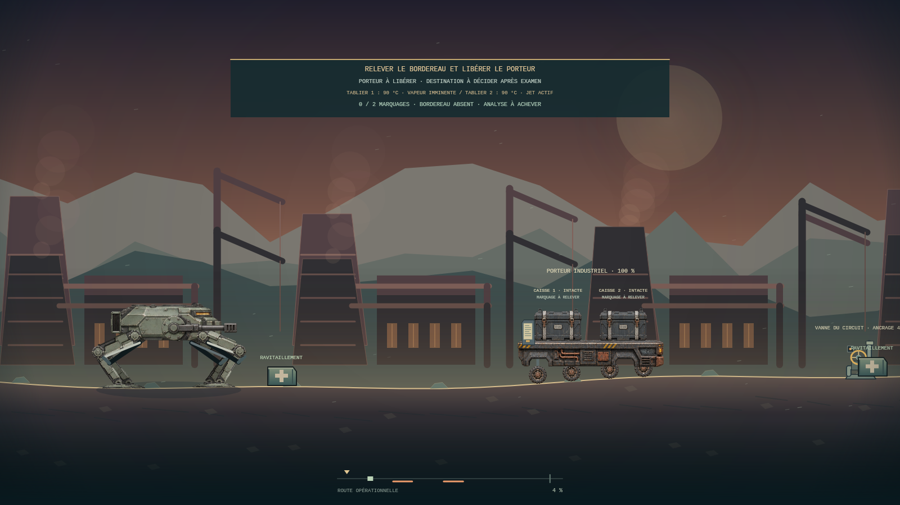
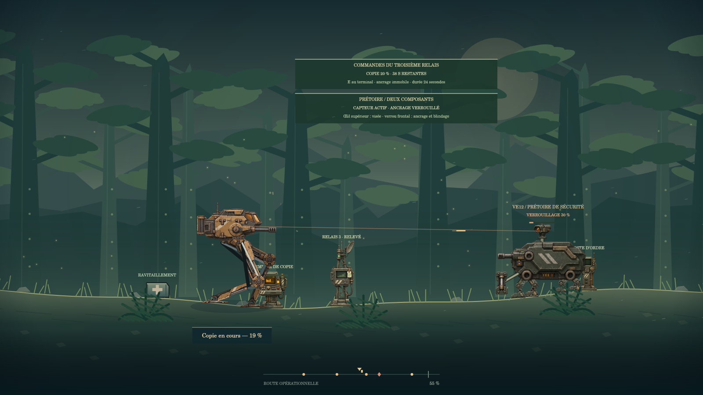

# Production 0.15.5 — Transports et troisième relais

**ORDRE DE CENDRE · 16 novembre 2026**

Cette tranche reprend les fichiers locaux de la 0.15.4, encore absents du `main` distant lors du début du travail, puis ajoute les images des machines déjà présentes dans MI02, MI05, MI07, MI08, MI12 et MI13. Elle livre **13 atlas PNG originaux et 80 cellules**, dont **77 utilisées au rendu et trois références de production**.

## Inventaire livré

| Lot | Fichiers | Cellules | Usage runtime | Références |
| --- | ---: | ---: | ---: | ---: |
| Train MI02 et porteur MI13 | 4 | 20 | 20 | 0 |
| Ambulance et embarcations de Nacre | 6 | 30 | 29 | 1 |
| Prétoire, mâts et consoles MI12 | 3 | 30 | 28 | 2 |
| **Nouvelle tranche 0.15.5** | **13** | **80** | **77** | **3** |

| Historique peint conservé | Atlas | Cellules |
| --- | ---: | ---: |
| Atelier MI14, 0.15.1 | 8 | 54 |
| Combat générique, 0.15.2 | 9 | 78 |
| Six marcheurs, 0.15.3 | 6 | 96 |
| Cerbère et Thyr, 0.15.4 récupérée | 9 | 78 |
| Transports, Nacre et MI12, 0.15.5 | 13 | 80 |
| **Total** | **45** | **386** |

Une cellule est une pièce, une silhouette ou un état graphique. Ces nombres ne désignent ni de nouveaux acteurs simulés, ni des animations finales, ni des missions supplémentaires. La campagne conserve quatorze missions, six châssis, trois opérations et le dossier v14.

## Train et transport industriel

La locomotive de MI02 possède une coque intacte, une coque endommagée, une épave et une roue séparée. L’atlas des wagons distingue minerai et captifs, leurs dégâts et leurs états ouverts. Les corps ne contiennent aucune roue dupliquée. Le renderer dessine les roues aux coordonnées existantes et raccorde les ferrures avec des ancres mesurées dans les PNG. La rotation suit le déplacement, puis conserve son orientation lorsque le train s’arrête.

Les fenêtres ne contiennent pas de personnes prépeintes. Le nombre visible découle des captifs restants ; la libération ou la destruction les retire. Les barreaux suivent l’état fermé. Le rendu ne prend aucune décision de sauvetage.

Le porteur de MI13 reçoit une cabine basse sous son plateau, trois états de carrosserie et une roue séparée. Ses quatre roues rejoignent les contacts de terrain calculés par la simulation. Les deux caisses gardent leurs positions propres sur le plateau puis pendant le transfert vers le quai. La caisse dispose des états scellé, marquage copié, endommagé et détruit ; l’état de dommage ne supprime pas une copie déjà acquise.

*Vue Canvas de MI13 obtenue par commandes publiques. Les caisses sont des objets séparés ; leur position n’est pas déduite de l’image du camion.*

## Ambulance et bateaux de Nacre

L’ambulance possède trois carrosseries et une roue séparée. Les deux centres de roue et leur rayon gardent leur géométrie de terrain. Un berceau relie visuellement la caisse médicale au toit sans déplacer son emplacement simulé. La caisse dispose de trois états ; la balise possède ses états attaché et perdu.

Après récupération, la balise disparaît du véhicule. Sa cellule isolée reste une référence : elle ne devient pas un objet porté ou un nouvel élément d’inventaire visible. Les quatre patients, les deux membres du personnel, leurs arrivées, pertes et consentements restent les faits de MI07.

Rive-Courte, Veille-Aval, le bateau civil et Saisie reçoivent des coques distinctes. Embarquement, trajet, arrivée, dégâts, perte et câble libéré sélectionnent les images lorsqu’un état correspondant existe. Les coques sont peintes vides ; les personnes et indicateurs existants sont dessinés séparément. Les quilles restent au repère physique du bateau, et aucune image n’augmente une capacité ou ne provoque un débarquement.

## Prétoire et appareils de MI12

Le Prétoire de sécurité reçoit une coque en trois états, ses segments articulés, pieds, canon, capteur et verrou. Son arme reste séparée et rejoint la même bouche que les projectiles, dans les deux directions. Le capteur et le verrou répondent à leurs dégâts réels ; le support de capteur reste attaché à la coque.

Les relais et consoles reflètent le relevé, la copie, la purge, l’isolement et la perte. L’arrivée du Prétoire reste différée jusqu’à l’alerte. Le canon endommagé et la cassette séparée sont les deux références de ce lot : le rendu ne crée ni santé d’arme ni cassette physique inexistante.

*Scène Canvas du chemin de mission public. La copie et le verrouillage sont en cours ; ce visuel n’est pas une capture de navigateur.*

## Origine, transparence et intégration

Les 13 fichiers sélectionnés sont des sorties de l’outil Imagegen intégré. Leurs octets sont conservés tels quels. Les [prompts transport](../assets/painted/transport/prompts.json), [Nacre](../assets/painted/nacre/prompts.json) et [relais](../assets/painted/relay/prompts.json) identifient les générations et corrections sélectionnées. La cabine du porteur a été abaissée par une édition Imagegen ; le voile de fond du matériel médical a été retiré par le même outil. Aucun script n’a retouché les pixels.

Les indexeurs Python mesurent l’alpha, les rectangles et les ancres. Les modules JavaScript dessinent directement les sous-rectangles des originaux. Ils conservent le repli vectoriel, les exports historiques et la réduction des mouvements. Aucun champ graphique n’entre dans la sauvegarde. La [réception des originaux](validation/release-v0155/generated-originals.json) compare chaque fichier à sa sortie de génération ; le [contrôle de conservation](validation/release-v0155/preservation.json) reçoit les sources protégées et preuves antérieures.

## Bible et édition hors ligne

Le [complément Bible](BIBLE_V15_5.md) met à jour 28 fiches existantes et conserve les 979 autres, tous les identifiants, statuts et critères initiaux. Le classeur garde 21 onglets, 126 formules et ses 1 007 fiches. La génération d’images ne promeut pas un lot au stade final.

L’édition autonome dépasse désormais 100 Mio. `npm run build` produit toujours l’HTML contenant code, styles et toutes les images, puis le place sans modification dans `dist/Ordre_de_Cendre.zip`. Le dépôt distribue ce ZIP ; il suffit de l’extraire puis d’ouvrir l’HTML. Cette enveloppe préserve les PNG originaux et le fonctionnement hors ligne. Le site web utilise les mêmes sources via `npm run build:web`.

Les contrôles exécutés et leur portée figurent dans le [rapport QA 0.15.5](QA_PAINTED_MISSION_ASSETS.md). La réception navigateur et les preuves de publication restent dans le [suivi de déploiement](DEPLOYMENT.md). Les animations finales, autres factions, populations, décors restants et missions MI15–MI32 gardent leurs travaux ouverts.
