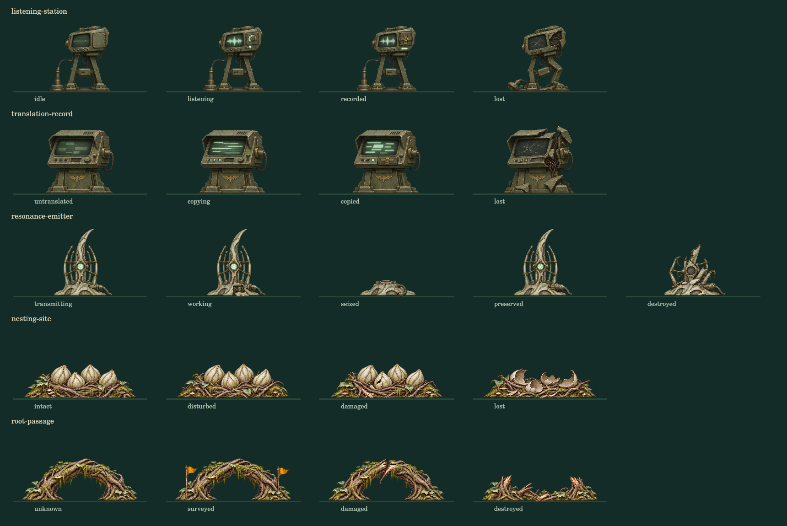

# Production 0.15.6 — Les installations de Nacre et de Thyr

**ORDRE DE CENDRE · 16 novembre 2026**

La tranche reprend l’arbre exact de la 0.15.5 publiée et ajoute **13 atlas PNG originaux, 75 cellules utilisées au rendu et aucune nouvelle cellule de référence**. Les objets concernés existent déjà dans MI05–MI08, MI10 et MI11 ; la livraison ajoute leurs images et états matériels, sans nouvelle mission ni nouvel acteur simulé.

| Lot | Atlas | Cellules runtime | Références |
| --- | ---: | ---: | ---: |
| Infrastructures de Nacre | 5 | 30 | 0 |
| Champ chimique MI10 | 5 | 24 | 0 |
| Appareils et sites de MI11 | 3 | 21 | 0 |
| **Nouvelle tranche** | **13** | **75** | **0** |

Les 45 atlas et 386 cellules antérieurs sont conservés. Le projet contient désormais **58 atlas / 461 cellules**, répartis en onze lots. Les cellules sont des pièces et des états graphiques ; elles ne représentent ni des personnes supplémentaires ni des cycles d’animation finaux.

## Nacre : digues, machines et accueils

Les cinq planches couvrent les panneaux et vantaux, les organes hydrauliques séparés, les deux familles de maisons, les abris et accueils, ainsi que les quais, rampes et treuils. Les rotors, volants et pièces mobiles disposent de leurs propres pivots. Les portes suivent leur levée physique et les raccords rejoignent les objets existants. Les effets de pression, l’eau, les câbles et les habitants continuent d’être dessinés à partir de leurs faits simulés.

Le [manifeste Nacre](../assets/painted/nacre-sites/manifest.json) décrit les 30 cellules. La réception figure dans [QA_PAINTED_NACRE_SITES.md](QA_PAINTED_NACRE_SITES.md).

## MI10 : identifier, prélever et contenir

Les cuves distinguent les états inconnus, identifiés, fuyants, isolés et détruits. Les appareils de prélèvement et le registre, les vannes, les canaux et les habitats complètent le champ. La perte d’un appareil n’invente aucune source ; les acquisitions déjà conservées restent acquises. Le rendu ne déplace pas les nappes, ne change pas un volume et ne restaure pas l’eau par sa seule apparence.

Les surfaces de pontage restent les vraies surfaces des pieds. Les habitats ne créent aucun recensement de population. L’herbe utilise désormais le PNG Thyr déjà disponible au lieu de son repli vectoriel.

Le [manifeste chimique](../assets/painted/chemical/manifest.json) reçoit 24 états. La réception figure dans [QA_PAINTED_CHEMICAL.md](QA_PAINTED_CHEMICAL.md).

## MI11 : écouter la vallée

L’écoute au sol et le récepteur de traduction possèdent chacun quatre états. L’émetteur distingue transmission, intervention, saisie, rétablissement et destruction. Son socle reste à la même échelle après saisie ; il n’est pas étiré à la hauteur d’un instrument entier.

La ponte et le repère de corniche possèdent chacun quatre états. Le repère de racines près du point de reconnaissance est un objet de présentation ; la corniche traversable reste calculée par `voiceSurfaceAt`. Les trois sites locaux ne deviennent pas une population nouvelle à partir des formes peintes.

*Planche de diagnostic Canvas, avec sélection explicite des états et repères de sol. Ce n’est pas une capture de mission.*

Le [manifeste MI11](../assets/painted/voice/manifest.json) reçoit 21 états. Les huit vues, les six tests dédiés et le parcours public se trouvent dans [QA_PAINTED_VOICE.md](QA_PAINTED_VOICE.md).

## Origine, intégration et conservation

Tous les PNG sélectionnés sont des sorties de l’outil Imagegen intégré. Les corrections de transparence sont elles aussi produites par Imagegen ; les scripts d’indexation mesurent l’alpha, les rectangles et les ancres sans modifier les pixels. Les prompts et la provenance sont conservés avec chaque lot.

Les trois nouveaux modules conservent le repli vectoriel en cas de défaut de chargement. Le HTML autonome embarque les originaux via les URL littérales et le site utilise les mêmes sources. Les modules de simulation, de sauvegarde et les fixtures historiques restent inchangés. La campagne demeure à 14 missions, 6 châssis, 3 opérations et un dossier v14.

La Bible conserve ses 1 007 IDs, ses statuts, ses critères et ses 21 onglets. Le [complément 0.15.6](BIBLE_V15_6.md) détaille les fiches actualisées. Le [suivi de publication](DEPLOYMENT.md) rattache les contrôles distants à leur commit ; les captures Canvas restent distinctes d’une réception native ou humaine.

## Travaux encore ouverts

Les installations de Vesper, certains appareils de MI09 et MI13, les autres biomes, les variantes de factions, les animations finales et les missions MI15–MI32 gardent leurs travaux ouverts. Les statuts de production ne sont pas promus à une qualité finale par la seule présence d’un atlas.
