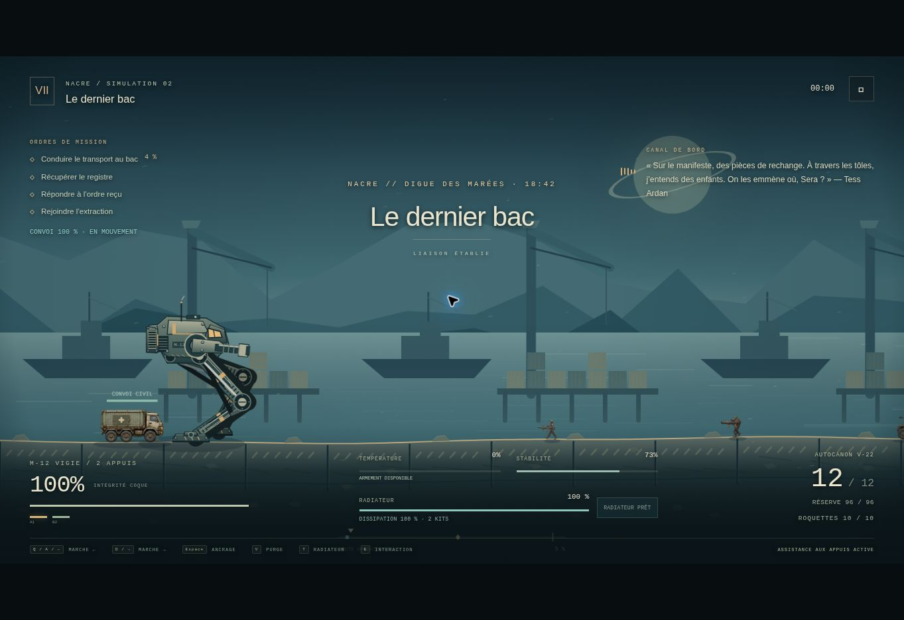

# QA 0.15.2 — Sprites de combat peints

## Périmètre

La réception porte sur neuf atlas transparents, leur intégration au renderer existant et le raccord physique de sept armes génériques. Elle conserve les huit atlas de l’atelier, les quatorze missions de campagne, six châssis, trois opérations et dossiers v14. Les résultats ci-dessous proviennent de la reprise du **16 novembre 2026**. Les anciennes preuves ne sont pas remplacées.

## Résultats automatiques

| Contrôle | Résultat et preuve |
| --- | --- |
| Simulation et intégration | **697/697 tests**, zéro échec et zéro ignoré ; [journal](validation/release-v0152/node-tests.txt), [empreintes source](validation/release-v0152/node-tests.json) |
| Catalogue et structure | 20 onglets de données, 1 007 fiches, six châssis, trois opérations, quatorze missions ; [journal](validation/release-v0152/project-check.txt) |
| Formes historiques SVG/Canvas | **174/174 cas** ; [journal](validation/release-v0152/assets-render.txt) |
| Nouveaux PNG réellement décodés | **9 atlas, 78 cellules**, un banc et cinq scènes Canvas ; [reçu](validation/painted-combat-v0152/receipt.json) |
| PNG MI14 conservés | **8 atlas, 54 cadres, 33 états isolés, 14 scènes, 85 dessins d’atlas** ; [nouveau reçu](validation/painted-mi14-v0152/receipt.json) |
| Interface statique et autonome | 213 IDs, 185 références, cinq vues, quatre archives, six dialogues ; [journal](validation/release-v0152/check-ui.txt) |
| Parcours du DOM modélisé | **108/108 parcours réussis** ; [journal dédié](validation/release-v0152/check-ui-runtime.txt), [bilan consolidé](validation/release-v0152/ui-painted-verification.json) ; ce contrôle n’est pas une exécution native de navigateur |
| Construction autonome | Environ **48,11 Mio, 37 modules**, images et styles intégrés sans ressource distante ; [journal](validation/release-v0152/build-offline.txt) |
| Construction web | `web-dist/index.html`, modules, styles et assets présents ; [journal](validation/release-v0152/build-web.txt) |
| Bible | 6 767 cellules comparées, 126 formules sans erreur et conservation de 996 fiches non affectées ; [réception du classeur](BIBLE_V15_2.md) |

Les tests du lot vérifient l’émission réelle des sept types de projectiles dans les deux directions, la correspondance des ancres et bouches après correction optique, les sept groupes d’arrivée différée, les labels et barres existants, la marche dépendant du déplacement et la réduction des mouvements. Ils contrôlent aussi les dimensions, les erreurs et annulations de décodage, les copies de rectangles et l’absence de mutation des données simulées.

Le nombre de cellules utilisées est **60** ; les **18 autres** restent des références. Les tests n’inventent ni cadavres persistants ni états de jeu pour les rendre actifs. Les corps incluent leurs roues/rotors : les pièces isolées ne sont pas superposées à ces composants déjà présents.

## Réception des images

`tools/test-painted-combat.mjs` décode les PNG avec `@napi-rs/canvas@0.1.100`. Il vérifie dimensions, transparence, occupation et limites des 78 rectangles, ainsi que la position des ancres. Le [banc de lecture](validation/painted-combat-v0152/combat-readability.png) emploie le renderer ordinaire dans les deux directions, à l’échelle ×2 et sur deux fonds de comparaison. Son placement est spécialement construit pour cette réception.

Les cinq scènes **OP01, OP02, MI05, MI09 et MI13** viennent de `createGame`, puis de 180 pas publics de simulation. Le [reçu](validation/painted-combat-v0152/receipt.json) conserve l’état, le type de preuve et les empreintes des images et sources. Ce sont des rendus Canvas ; leur production ne constitue pas une session de jeu native. Les scènes de mission conservent les corps propres à leur domaine : la présence d’une planche générique n’en remplace pas toutes les machines particulières.

La relecture du banc confirme un fond transparent, des corps lisibles dans les deux orientations et des armes raccordées, sans roue ni canon en double. OP02 et MI05 ont également été ouverts pour examiner leur échelle dans le terrain. La finesse des traits à l’échelle du jeu et la qualité des transitions restent soumises à une réception artistique et à un essai humain.

## Tentative automatisée dans Chromium local

Le nouveau script `tools/test-painted-combat-browser.mjs` attend explicitement le chargement des **huit atlas MI14 et des neuf atlas de combat**, puis prépare un parcours distinct. La tentative locale a été bloquée **au lancement de Chromium**, avant toute page : `socket() failed: Operation not permitted`, `ptrace: Operation not permitted`, puis `SIGABRT`.

Le [rapport 0.15.2](validation/painted-combat-browser-v0152/report.json) conserve **une tentative, zéro page, zéro parcours exécuté et zéro capture**. Aucun autre chemin local n’a été utilisé pour contourner ce blocage. Les résultats du DOM modélisé et de Canvas restent valides dans leur périmètre, mais ne sont pas présentés comme une réception Chromium. Les anciennes preuves navigateur restent inchangées. Un essai humain n’a pas été réalisé.

## Réception courte de Chrome sur la production

Après publication du commit **`6c788a3431a3738be69a61065c0facc64379279b`** et confirmation du déploiement **`dpl_6ocHZAasgPEW28sr9t8Xk9Z6o9RE`** en production READY, le navigateur partagé a rechargé [imperium-march.vercel.app](https://imperium-march.vercel.app/). Il affiche **VERSION 0.15.2 et quatorze missions**, avec MI12, MI13 et MI14. Ce contrôle passe par le site public ; il ne relance pas le Chromium local bloqué.

La sélection de **Simulation 02 — Le dernier bac**, le briefing et le bouton de déploiement ont ouvert le terrain avec le M-12 Vigie. Les nouveaux sprites du convoi et des fusiliers sont visibles. La commande de marche a fait passer le convoi de l’attente au mouvement et son objectif de **3 % à 4 %**. Échap ouvre la pause ; Reprendre revient au terrain ; une seconde pause est reçue. Le dossier de campagne n’a été ni importé ni réinitialisé.

Le [reçu natif](validation/native-v0152/receipt.json) conserve la portée exacte et les empreintes de **quatre captures originales du navigateur** : [campagne](validation/native-v0152/campaign-v0152.jpg), [premier affichage](validation/native-v0152/combat-op02-v0152.jpg), [après reprise](validation/native-v0152/combat-op02-resumed-v0152.jpg) et [pause](validation/native-v0152/paused-v0152.jpg). La préversion Vercel demandait une connexion ; sa protection a été conservée et l’interaction a été faite sur le domaine public de production.



*Capture réelle de Chrome après reprise et commande de marche. Cette réception courte ne termine pas une mission, ne contrôle pas les dix-sept états de décodage, ne mesure pas les performances et ne remplace pas un essai humain. QA230 et QA231 ne sont pas clôturées par ce parcours OP02. Le rapport local bloqué demeure conservé avec ses résultats propres.*

## Reproduction

```sh
npm test
npm run build
npm run check
npm run check:ui
npm run check:ui-runtime
npm run check:assets-render
node tools/test-painted-sprites.mjs ../outputs/painted-mi14-qa
node tools/test-painted-combat.mjs ../outputs/painted-combat-qa
npm run build:web
```

Les deux contrôles raster nécessitent les dépendances de développement documentées. Choisir de nouveaux dossiers pour conserver les réceptions précédentes. Dans un environnement autorisant Chromium et Playwright, `npm run check:combat-browser` exécute le parcours natif ; ses résultats doivent être reçus séparément.

La publication GitHub, sa CI et le déploiement sont suivis dans [DEPLOYMENT.md](DEPLOYMENT.md). Aucune réception de fichier local ne vaut preuve que le site sert déjà les mêmes octets.
