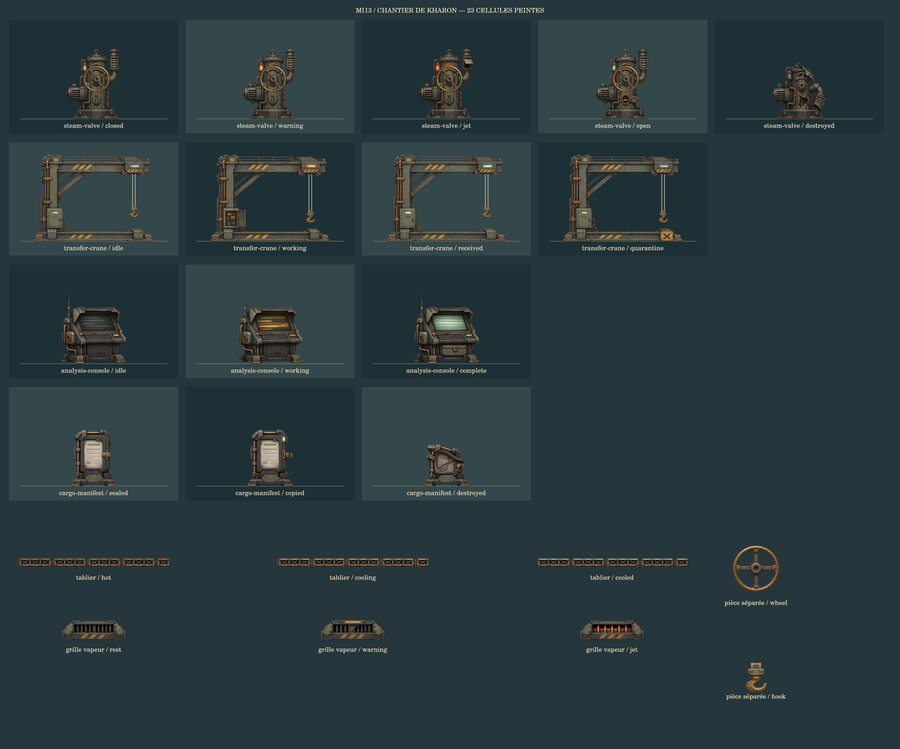

# Réception du chantier peint de MI13 — 0.15.7

## Périmètre reçu

Quatre PNG originaux Imagegen, 23 cellules utilisées au rendu et une case de grille vide. Les sources PNG sont conservées sans retouche, avec leurs prompts, empreintes et mesures dans [`assets/painted/foundry-sites`](../assets/painted/foundry-sites/README.md).

| Famille | États ou pièces | Cellules |
| --- | --- | ---: |
| Vanne de vapeur | Fermée, avertissement, pression active, circuit isolé, détruite et volant séparé. | 6 |
| Grue | Attente, travail, réception, quarantaine et crochet séparé. | 5 |
| Console et bordereau | Trois états de console, trois états matériels du bordereau. | 6 |
| Tablier et grille vapeur | Trois états thermiques du tablier, trois états de grille. | 6 |
| **Total** | **4 atlas de 1536 × 1024 pixels.** | **23** |

## Vérifications exécutées

`node --test tests/painted-foundry-sites.test.mjs` : **8 tests réussis**. Ils vérifient la couverture des états, l’échec de décodage limité à son atlas, le nettoyage d’un chargement périmé, le volant unique à son pivot, le crochet pendant un transfert en quarantaine, les surfaces réelles, la restauration de la pile Canvas après erreur et la conservation exacte des faits de simulation.

`python3 tools/index-painted-foundry-sites.py` vérifie les dimensions, les cellules, les bords transparents et les ancres. Il écrit le manifeste et le layout sans toucher aux PNG. Les quatre fichiers occupent **7 816 066 octets** ; leurs fractions de pixels totalement transparents vont de 44,97 % à 70,17 %.

`node tools/test-painted-foundry-sites.mjs docs/validation/painted-foundry-sites-v0157` : **4 décodages PNG, 23 cellules et 8 vues Canvas**. Les empreintes d’entrée, contrôles de transparence, rectangles et sources figurent dans le [reçu](validation/painted-foundry-sites-v0157/receipt.json).

## Scènes obtenues

Le pilote public de MI13 demeure inchangé. Une sortie WK09, difficulté Normal, graine 157 et choix `defy` atteint la victoire avec PT03 acquise. Six copies profondes d’états ont été conservées pendant cette sortie, puis rendues : arrivée, manœuvre de vanne, refroidissement, analyse de Tess, transfert en quarantaine et réception avant transmission du rapport. Chaque rendu vérifie qu’il ne change pas les données sauvegardables. Cette sortie automatique ne constitue pas une partie humaine.

La planche d’états sélectionne explicitement les poses pour inspecter leur lisibilité et leurs raccords. Le diagnostic thermique utilise trois copies de scène dont les phases sont choisies pour comparer avertissement, jet et circuit isolé ; il ne prétend pas représenter trois étapes obtenues par commandes publiques.

## Invariants conservés

Le tablier suit `foundrySurfaceAt`, y compris ses pentes. Son image n’ajoute aucun appui. La texture reste liée au début du pont lors du déplacement de caméra. Les grilles ne contiennent aucune vapeur prépeinte : la vraie phase du jet, ses dimensions dangereuses et sa température restent sous l’autorité de la simulation.

Le volant et le crochet sont des pièces séparées, dessinées une seule fois. La grue conserve son signal de quarantaine pendant le mouvement du crochet. Cette articulation reste une présentation du transfert : elle ne déplace pas les caisses et n’introduit aucune contrainte physique fictive.

La copie d’un bordereau, l’analyse de Tess, l’arrivée du porteur et le transfert de chaque caisse restent distincts. Un document détruit ne supprime pas une copie déjà acquise. Une vanne détruite n’annule pas un circuit déjà isolé. Les corps, collisions, stocks, copies et dossiers v14 sont inchangés.

## Limites de réception

La présente réception porte sur Node et Canvas/Skia. Elle ne revendique ni navigateur interactif, ni mesure de performance sur matériel utilisateur, ni essai humain. Les apparitions adverses, règles de combat et campagnes sont contrôlées par les tests globaux du projet, dont les résultats de la tranche sont consignés séparément. Les atlas et preuves des versions antérieures restent historiques.
