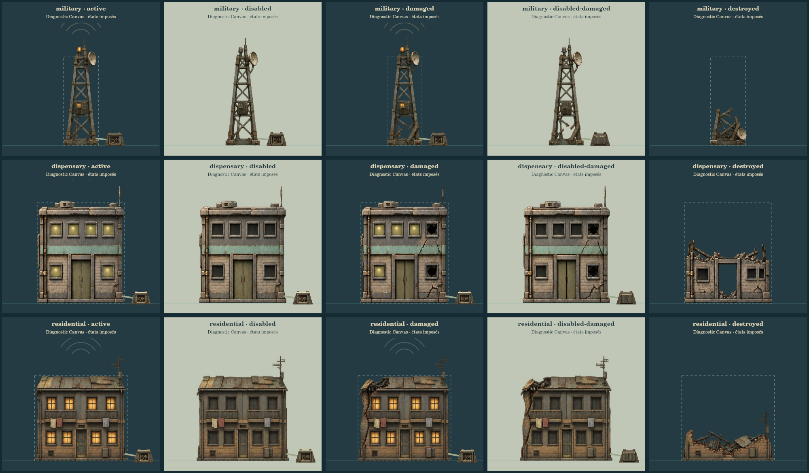
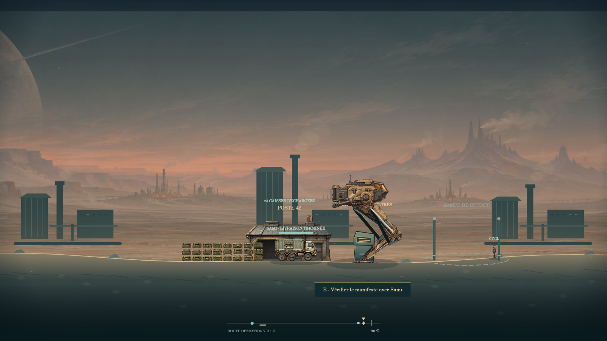

# Réception des sites et machines peints de Vesper — 0.15.7

Cette réception couvre **six atlas PNG originaux, 38 cellules de rendu, dix tests ciblés et quatorze vues Canvas**. Elle utilise le décodage réel des images et Skia Canvas via `@napi-rs/canvas`. Les neuf scènes de mission proviennent de commandes publiques de la simulation ; les cinq planches de diagnostic sélectionnent explicitement des états de présentation. Aucun test navigateur, essai humain ou achèvement de mission n'est revendiqué par ce rapport.

Le lot est une nouvelle production à partir de la version publique 0.15.6. Les octets d'un travail non publié antérieur en 0.15.7 n'ont pas été récupérés. La provenance des six originaux, les demandes Imagegen et leurs corrections sélectionnées sont documentées dans [prompts.json](../assets/painted/vesper/prompts.json) et [manifest.json](../assets/painted/vesper/manifest.json).

## Contrôles ciblés

Les dix tests de [painted-vesper.test.mjs](../tests/painted-vesper.test.mjs) ont réussi :

1. Les 38 cellules sont adressables, bornées dans leur cellule d'origine et accompagnées de métadonnées défensives. Les dimensions réelles de l'habitat et les rangées inégales sont reconnues ; les appareils sans santé locale ne reçoivent pas d'état détruit inventé.
2. Courant coupé, dégâts et destruction sélectionnent leurs états indépendants. Le seuil de dégâts reste strictement inférieur à 75 % de santé, avec priorité à la destruction.
3. Les trois bâtiments du réseau conservent leurs cinq états et leur terminal séparé, posé sur le vrai terrain. Le terminal disparaît avec sa station détruite.
4. Les deux familles de treuil dessinent une carcasse et une roue ou bobine, une seule fois chacune, autour du socket mesuré. La réduction des mouvements garde la pièce immobile.
5. Chaque turbine possède une seule carcasse et un seul rotor. L'axe source rejoint le centre historique `turbine.y - 8`, à chaud comme à froid, y compris avec mouvement réduit. Le rayon balayé reste à l'intérieur du passage libre des deux carters.
6. Le rendu complet des quatre missions MI01–MI04, dans les deux réglages de mouvement, conserve exactement la sérialisation de la simulation et équilibre les sauvegardes/restaurations du contexte Canvas.
7. Aucun morceau de conduite peint ne traverse le trou de rupture. Conduites et dalles suivent les mêmes échantillons de terrain ; les bornes du passage protégé restent celles de la mission.
8. Le dépôt reste à sa position existante et les caisses sont au nombre exact de 24, uniquement après livraison.
9. L'absence de décodage et les dimensions invalides gardent le repli vectoriel. Un chargement terminé après `clearPaintedVesper` ne réinstalle pas d'image périmée.
10. Un échec de `drawImage` retire l'atlas concerné, restaure le contexte et laisse le chemin vectoriel disponible ; une bande de terrain invalide ne produit pas de dessin.

Le contrôle Canvas compare les empreintes des six fichiers avec celles du manifeste et des sorties sélectionnées. Chaque original possède plus de 40 % de pixels totalement transparents. Au seuil alpha 32, chaque silhouette est entièrement contenue dans sa découpe ; les cellules réservées sont vides. Les correspondances de points source/cible sont vérifiées numériquement. Aucun original PNG n'est réécrit par l'indexeur ou la réception.

## Diagnostics d'états

| Vue | Portée |
| --- | --- |
| [vesper-source-cells.png](validation/painted-vesper-v0157/vesper-source-cells.png) | Les 38 découpes sélectionnées sur deux fonds alternés ; pas de scène de mission. |
| [network-states-diagnostic.png](validation/painted-vesper-v0157/network-states-diagnostic.png) | Trois familles de stations et cinq états chacune. Les rectangles cyan représentent le corps physique vulnérable ; les terminaux restent séparés. |
| [controls-diagnostic.png](validation/painted-vesper-v0157/controls-diagnostic.png) | Pompe, turbine avec rotor, radio et harpon avec bobine ; états imposés et variante de mouvement réduit. |
| [maintenance-states-diagnostic.png](validation/painted-vesper-v0157/maintenance-states-diagnostic.png) | Poste intact, endommagé avec copie conservée et détruit. La ruine garde son échelle, sans terminal survivant dessiné. |
| [pipe-and-delivery-diagnostic.png](validation/painted-vesper-v0157/pipe-and-delivery-diagnostic.png) | Conduite intacte/rompue, dalles partielles/verrouillées et dépôt avant/après livraison. |

Ces planches changent des états dans des copies distinctes de scène pour inspecter les combinaisons graphiques. Elles ne prouvent ni l'obtention de ces états en mission ni une nouvelle règle de gameplay.



*Diagnostic Canvas d'états imposés. Les ruines ne sont pas agrandies à la hauteur de la station intacte ; les formes décoratives au-dessus des rectangles cyan ne changent pas les colliders.*

## Scènes obtenues par commandes publiques

Toutes les scènes ci-dessous démarrent avec `createGame`, le châssis WK01, la difficulté histoire et la graine 1577. Les pilotes utilisent `commandGame` et `updateGame`, sans modifier les faits de la partie en cours. Le renderer est appelé avec la caméra normale en 1600 × 900, sans changement de cadrage pour dégager les objets. Chaque vue conserve un fichier `.state.json` et ses empreintes dans [receipt.json](validation/painted-vesper-v0157/receipt.json).

| Mission et fichier | Checkpoint réellement atteint | Temps simulé |
| --- | --- | ---: |
| [MI01 — treuil en travail](validation/painted-vesper-v0157/mi01-winch-working.png) | `passageWorking` et `passageProgress > .45`. | 7,65 s |
| [MI01 — passage protégé](validation/painted-vesper-v0157/mi01-protected-passage.png) | `passageSecured` et joueur au-delà de x = 1140, au passage réel. | 14,85 s |
| [MI01 — filtres livrés](validation/painted-vesper-v0157/mi01-filters-delivered.png) | `filtersDelivered`, avec 24 caisses visibles au dépôt. | 80,03 s |
| [MI02 — second harpon](validation/painted-vesper-v0157/mi02-second-harpoon.png) | Second harpon en travail avec progression supérieure à 45 % ; premier harpon déjà libéré. | 18,50 s |
| [MI03 — inspection du dispensaire](validation/painted-vesper-v0157/mi03-dispensary-inspection.png) | Station du dispensaire en inspection au-delà de 45 %. | 30,63 s |
| [MI03 — habitat vérifié](validation/painted-vesper-v0157/mi03-housing-verified.png) | Station résidentielle vérifiée, terminal protégé ; les murs restent vulnérables. | 52,70 s |
| [MI04 — raccordement de pompe](validation/painted-vesper-v0157/mi04-pump-connection.png) | Pompe en travail avec progression supérieure à 45 %. | 7,35 s |
| [MI04 — refroidissement de turbine](validation/painted-vesper-v0157/mi04-turbine-cooling.png) | Première turbine en travail avec progression supérieure à 45 %. | 18,58 s |
| [MI04 — copie de maintenance](validation/painted-vesper-v0157/mi04-maintenance-copy.png) | Journal réellement copié. À ce checkpoint, les deux turbines sont refroidies et l'appel disponible a été accompli. | 57,25 s |

MI01 utilise une politique de commandes dérivée du pilote public du test de campagne existant. MI02, MI03 et MI04 utilisent leurs pilotes publics déjà présents dans `tests/helpers/`. Les exécutions sont arrêtées aux checkpoints indiqués ; elles restent dans l'état `playing`. Ce lot ne présente aucune victoire supplémentaire.

MI04 commence avec le contexte explicitement configuré suivant : conduite rompue, services interrompus, trois ouvriers secourus, dispensaire intact, témoin joignable et deux relais civils en ligne. Ce choix rend les interventions observables ; ce n'est pas un dossier obtenu en rejouant successivement MI01–MI03. La pompe locale rétablit le refroidissement industriel sans réparer la conduite civile. Les faits de copie et d'appel sont acquis pendant le parcours public MI04 lui-même.



*Scène Canvas avec caméra ordinaire. La livraison vient de la simulation ; l'image du dépôt ne déclenche aucun fait de campagne.*

## Relecture et limites

Les quatorze vues ont été ouvertes et inspectées. Les cellules n'empruntent pas de pixels aux voisines, les alpha laissent voir les fonds, les portes et bases rejoignent le sol, et les ruines restent basses. La conduite rompue garde son interruption et les dalles suivent le profil existant. Les caisses apparaissent uniquement après livraison. Les occlusions normales par le marcheur sont conservées dans les scènes de travail ; les diagnostics permettent de voir séparément les objets.

La première réception montrait un rotor trop large devant la turbine. La correction porte uniquement sur sa taille de dessin : diamètre nominal de 38 unités, rayon balayé de 19,17, pour un rayon libre minimal mesuré de 19,9 dans l'ouverture des carters. La couronne métallique reste visible ; le pivot, le comportement et les octets PNG sont inchangés. Le cadrage de la planche de conduite a également été relevé pour montrer entièrement les bandes situées sous le niveau du sol.

Les libellés, jauges, câbles, effets de travail et informations de mission restent dessinés par le moteur. Les sprites ne créent aucune nouvelle population, preuve, perte, santé de composant ou surface physique. La réduction des mouvements est testée sur les pièces qui tournent ; cette réception de poses ne constitue pas une validation humaine d'animation.

Les images n'incluent pas le DOM du navigateur, l'entrée native au clavier ou à la manette, l'audio ni une mesure de performance matérielle. Les critères navigateur et humains, notamment QA230/QA231 et les 133 critères initiaux de production, ne sont pas clôturés par ces résultats.

## Reproduction

```sh
node --test tests/painted-vesper.test.mjs
node tools/test-painted-vesper.mjs docs/validation/painted-vesper-v0157
```

Le second contrôle requiert `@napi-rs/canvas`. Dans l'environnement géré, il peut charger cette dépendance depuis `CODEX_PRIMARY_RUNTIME_NODE_MODULES`. Pour une nouvelle version, utiliser un nouveau dossier de sortie afin de préserver cette réception et les preuves historiques. Les dimensions, empreintes, noms de fichiers, états publics, sources contrôlées et limites sont conservés dans le reçu JSON.
