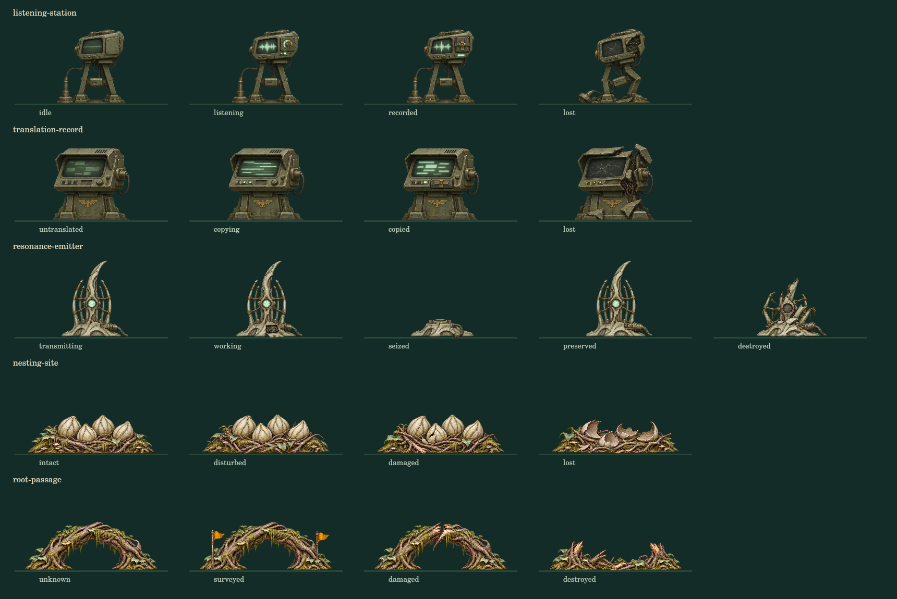
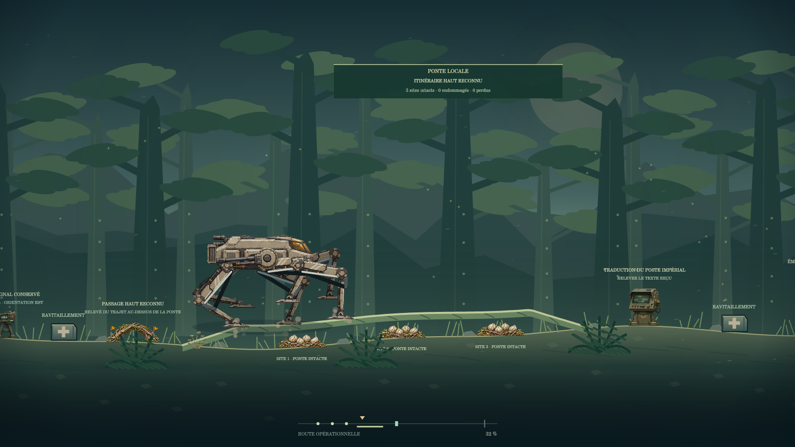

# Réception des appareils et sites peints de MI11 — 0.15.6

Cette réception couvre **trois PNG originaux et 21 cellules de rendu** : écoute au sol, traduction impériale, émetteur, sites de ponte et repère de corniche. Elle utilise le décodage PNG et Skia Canvas via `@napi-rs/canvas`. Elle ne constitue ni une capture de navigateur ni un essai humain.

## Résultats

- Six tests ciblés réussis : empreintes et cellules, échecs de chargement et promesses périmées, ancres et échelle de la saisie, absence de mutation de scène, conservation des copies après perte des originaux et sélection des 21 états.
- Trois images RGBA réellement décodées, avec plus de 30 % de pixels totalement transparents chacune. Les silhouettes au seuil alpha 32 tiennent dans leurs cellules ; la sixième case vide de l’émetteur n’est pas indexée.
- Huit vues Canvas : une planche de diagnostic des 21 états et sept scènes du pilote public MI11. Les sept scènes sont l’arrivée, l’écoute en cours, le franchissement de la ponte, la copie de traduction, la copie source, l’émetteur rétabli et son observation après éloignement du marcheur.
- Le pilote existant a réellement atteint `won` avec le choix `defy` à **136,8166667 secondes simulées** : trois sites intacts et TE01 acquis. Il utilise les commandes publiques ; les états capturés sont copiés profondément puis rendus sans mutation.
- Les trois fichiers intégrés sont identiques, octet pour octet, aux sorties Imagegen sélectionnées. L’indexation ne retouche aucun pixel.

*Planche de diagnostic Canvas. Les états sont sélectionnés explicitement ; cette planche n’est pas un parcours de mission.*

*Scène issue des commandes publiques du pilote MI11. La surface porteuse demeure calculée par la simulation ; le petit repère de racines ne la remplace pas.*

## Vérification visuelle et limites

Les huit images ont été ouvertes et relues. Les appareils reposent sur leur base, les objets perdus restent au bon ancrage, la transparence laisse voir le fond et les sites ne débordent pas leurs cellules. Une capture après éloignement du marcheur rend l’émetteur rétabli entièrement visible ; les captures de travail conservent les occlusions normales par la machine.

Les libellés et barres de progression restent ceux du moteur. Un dessin de copie acquise ne crée pas de preuve ; une perte de support n’efface pas une copie déjà acquise. Leth, son consentement, les avertissements et le récit restent inchangés. Les animations finales et la réception humaine gardent leurs critères ouverts.

Commandes : `node --test tests/painted-voice.test.mjs` puis `node tools/test-painted-voice.mjs docs/validation/painted-voice-v0156`.

Les empreintes, coordonnées et scènes figurent dans [receipt.json](validation/painted-voice-v0156/receipt.json). Les originaux sélectionnés sont rapprochés dans [originals.json](validation/painted-voice-v0156/originals.json).
